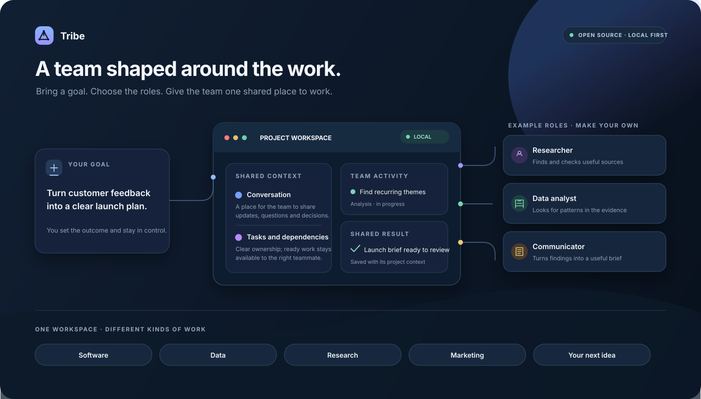
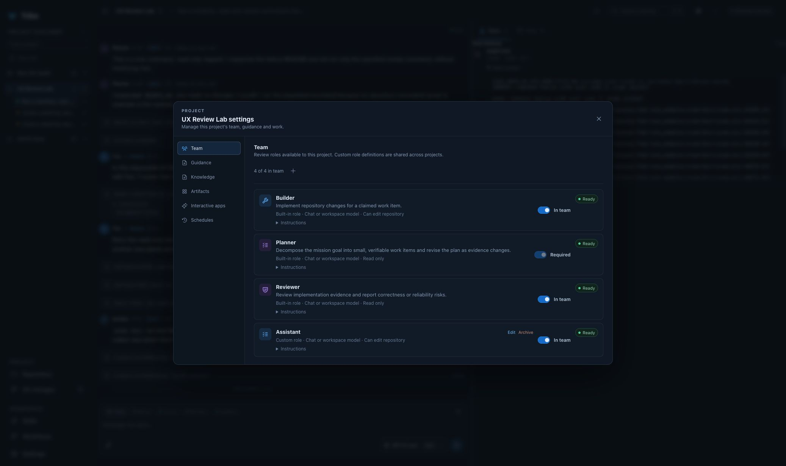

# Tribe — Open-Source Workspace for AI Agent Teams

**Build a team of AI agents around the work you want to do.** Tribe is a local-first desktop workspace for composing role-based teams, giving them shared context and tasks, and following their work from one place.

<p align="center">
  <a href="https://github.com/Diagramotion/Tribe/releases/latest"><strong>Download Tribe</strong></a> ·
  <a href="#how-a-tribe-team-works">How it works</a> ·
  <a href="#why-tribe-is-different-from-an-agent-harness">Why Tribe</a> ·
  <a href="#build-from-source">Build from source</a> ·
  <a href="CONTRIBUTING.md">Contribute</a>
</p>

<p align="center">
  <a href="https://github.com/Diagramotion/Tribe/actions/workflows/desktop.yml"></a>
  <a href="https://github.com/Diagramotion/Tribe/actions/workflows/codeql.yml"></a>
  <a href="LICENSE"></a>
</p>



*Illustrative overview of Tribe. The role names and team shown are examples; you choose or create roles to fit the work.*

Tribe is an **open-source AI agent team workspace**. It gives people a way to bring different AI roles together around a shared goal—whether the work involves software, data science, data engineering, research, marketing or another field. Each team works in a project space with a conversation, shared tasks, context and results.

You choose the model providers, the team roster and each role’s tool permissions. The desktop app, project data and agent runtime run locally. If you connect a hosted model, the prompt and relevant context for that request go to that provider.

## Make a team for the work

Tribe does not require a fixed cast of “Planner, Builder and Reviewer” agents. Each project needs a Planner role for shared intake and planning; you choose or create the rest of its reusable role profiles to suit the work.

For example, a research project might use a researcher, a source checker and a synthesiser. A data project might bring together an analyst, an engineer and a documentation writer. A marketing project might use audience research, campaign strategy and copywriting roles. A software project could use implementation, test and review roles. These are starting points, not product presets or required line-ups.

Every role has its own instructions, model preference and explicit tool grants. The name of a role does not grant it extra access. What a team can do depends on its profiles, the tools and connections you configure, and the approvals you allow.



*The product UI: each project has its own roster; reusable role profiles can be adapted to the work.*

## How a Tribe team works

1. **Set the goal.** Start a project from a local folder or create a project space for other work. Git is optional.
2. **Choose the team.** Select reusable roles for the project, adjust their guidance and grant only the capabilities they need.
3. **Work in one shared space.** Ask the team a question or give it an outcome to pursue. The planning role turns unaddressed requests into owned tasks with clear prerequisites.
4. **Let ready roles contribute.** Independent teammates claim available work, share findings or direct messages, and use their granted tools.
5. **Review the result.** Follow meaningful replies and approvals in chat, execution detail in the activity timeline, and files or shared documents beside the conversation.

Tasks keep their owners and dependencies, so the team can work on independent items without losing track of what is waiting. You can inspect the plan, change the team, approve sensitive actions and review the outcome.

## Why Tribe is different from an agent harness

An **AI agent harness** typically provides an agent’s model loop and capabilities such as file access, shell commands or integrations. Tribe uses composable harness capabilities for those standard functions. Its product focus is what surrounds the individual run: a team people can shape, a shared place for that team to work, and a durable view of how the work progresses.

| Many agent harnesses centre on… | Tribe centres on… |
|---|---|
| Configuring and running an individual agent | Assembling a project-specific team from reusable roles |
| A prompt, tool loop and response | Shared conversations, tasks, prerequisites and team messages |
| Work that is easy to lose between runs | Project context and outcomes that remain available as work continues |
| Capabilities configured at the runner level | Explicit role grants and approval rules around team actions |

Harnesses vary, and some also support multi-agent patterns. Tribe’s distinction is the user-facing team workspace and its coordination model—not a claim that no other tool can run multiple agents.

## Coordination without a central AI orchestrator

Tribe’s “zero orchestration” idea is about where control lives. A hidden, model-powered super-agent does not direct every role or tool call. The planning role proposes shared work; independent role workers use durable team state to find and claim tasks whose prerequisites are met. A lightweight local supervisor manages worker lifecycles, while Tribe enforces project policy, permissions and approvals.

This keeps collaboration visible and recoverable: tasks have owners, messages and outcomes are recorded, and independent work can proceed in parallel. The team is coordinated, but its entire decision path does not live inside one opaque agent run.

For technical details, see [runtime and application architecture](docs/runtime-foundation.md), the [capability roadmap](docs/parity-roadmap.md) and [security guidance](SECURITY.md).

## A vision for practical AI teamwork

Tribe is being built towards a simple idea: people should be able to assemble the AI collaborators a goal needs, give them a shared place to work, and remain able to see and shape what happens.

That vision reaches beyond one profession or one model. It means adaptable teams, visible coordination, portable project context, user-controlled permissions and dependable local work. The roadmap tracks how Tribe is moving towards it; it also shows what is implemented today and what is still ahead.

## Download Tribe

The latest desktop release provides installers for **Apple Silicon macOS** and **64-bit Windows**.

**[Download the latest release](https://github.com/Diagramotion/Tribe/releases/latest)**

The macOS download is a zipped `.app`; Windows downloads include MSI and NSIS installers. Releases include SHA-256 checksums. Desktop installers are currently unsigned, so macOS Gatekeeper or Windows SmartScreen may show an initial trust prompt. Review the checksum and source before installing.

The Tauri desktop release includes the local Python runtime. The managed Chromium browser is being developed in a separate Electron shell and is not included in these installers.

## Models, privacy and permissions

Tribe supports `provider:model` identifiers, common hosted providers, OpenAI-compatible endpoints, LiteLLM gateways and local model services such as [Ollama](https://ollama.com/). Tribe does not bundle model inference or provider subscriptions; you configure your own provider access.

The application, project folders and workspace data are local. If you use a hosted model, Tribe sends the prompt and project context needed for that request to the configured provider. Provider pricing, data handling and terms are set by that provider. A local model endpoint can keep inference on your machine or network.

Each role’s available tools come from its profile grants. Sensitive or external actions can require approval. Read [SECURITY.md](SECURITY.md) for security boundaries and vulnerability reporting.

## Build from source

### Requirements

- Node.js 22
- Python 3.11 or later
- [uv](https://docs.astral.sh/uv/)
- Rust toolchain for the Tauri desktop application

### Run the workspace preview

```sh
git clone https://github.com/Diagramotion/Tribe.git
cd Tribe
npm ci
uv sync --project runtime --extra ai
npm run dev
```

Open the local URL printed by Vite. Add a project, select its team and configure a model provider in **Settings** to run model-backed agents.

### Run the desktop application

```sh
uv sync --project runtime --extra ai --extra desktop
npm run desktop:dev
```

For development checks and packaging details, see [CONTRIBUTING.md](CONTRIBUTING.md) and [runtime and application architecture](docs/runtime-foundation.md).

## Frequently asked questions

### What is Tribe?

Tribe is an open-source, local-first workspace for configurable AI agent teams. It brings role-based agents, shared project context, team communication and durable work tracking into one desktop app.

### Can I use Tribe for work beyond software development?

Yes. Teams can be composed for research, marketing, data science, data engineering, software and other project work. A role’s practical abilities depend on its instructions, granted tools, model and connected services.

### Does Tribe come with a fixed team of agents?

No fixed cast is required. Each project has one required Planner role; you choose or create the other role profiles for that project. Built-in roles are starting points, and role definitions can be customised.

### How is Tribe different from an AI agent harness?

Tribe uses harness capabilities to run agents, then adds a local-first workspace around teams: reusable project rosters, shared conversations and tasks, durable activity, role-based permissions and approvals.

### Does Tribe need Git?

No. A project can use a local folder without Git. Git-enabled projects also show repository status and file changes.

### Does Tribe send my data to an AI provider?

The app and project data stay local. With a hosted model, the prompt and relevant context for that request are sent to its provider. You can instead connect a local model endpoint.

### Which operating systems are supported?

The current Tauri desktop release targets Apple Silicon macOS and 64-bit Windows. The managed Chromium browser is part of a separate Electron shell and is not included in the release installers.

## Roadmap and contributing

Tribe is developed in the open. See the [capability roadmap](docs/parity-roadmap.md) for current implementation status and planned work. Bug reports, focused fixes, and documentation or design contributions are welcome; start with [CONTRIBUTING.md](CONTRIBUTING.md). Report security issues using the private process in [SECURITY.md](SECURITY.md).

## Licence

Tribe is available under the [Apache License 2.0](LICENSE). Third-party components and assets may have separate terms; retain their notices and review the relevant upstream licence before redistribution. Python runtime notices are in [THIRD_PARTY_NOTICES.md](runtime/tribe_runtime/THIRD_PARTY_NOTICES.md).
