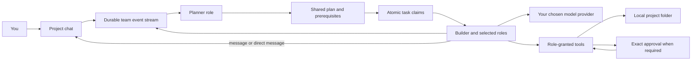
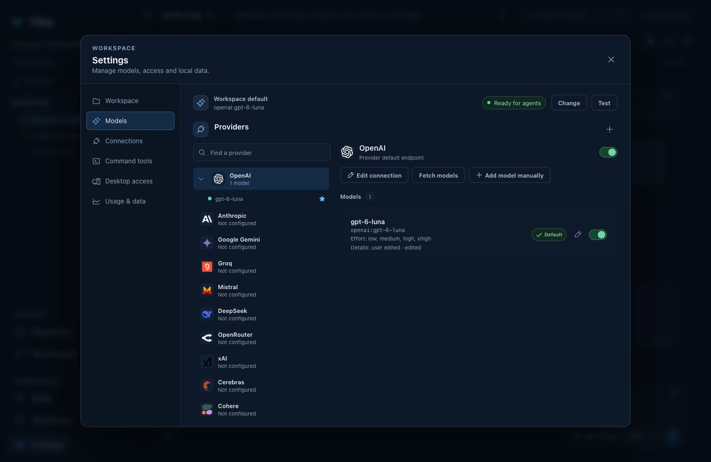

# Tribe — Local-First AI Team Workspace for Software Engineering

<p align="center">
  <strong>A local-first AI team workspace for software engineering.</strong><br>
  Give your project a team of focused agents, a shared plan, and a durable place to do the work.
</p>

<p align="center">
  <a href="https://github.com/Diagramotion/Tribe/releases/latest">Download Tribe</a> ·
  <a href="#how-the-team-works">How the team works</a> ·
  <a href="#coordination-without-a-black-box-orchestrator">Architecture</a> ·
  <a href="#build-from-source">Build from source</a>
</p>

<p align="center">
  <a href="https://github.com/Diagramotion/Tribe/actions/workflows/desktop.yml"></a>
  <a href="https://github.com/Diagramotion/Tribe/actions/workflows/codeql.yml"></a>
  <a href="LICENSE"></a>
</p>

Tribe turns AI coding assistance into a **project team that can plan, work and communicate together**. Talk to the team in a shared project chat. A Planner breaks requests into owned work; Builders and other selected roles claim ready tasks, use the tools their profiles permit, and report progress in the same durable conversation. You stay in control of the project folder, the team roster, model providers and approvals.

The workspace, project state and agent runtime run locally. When you choose a hosted model, prompts and the context needed for that request go to its provider. You can also connect a local model endpoint.


*Choose the roles that can work in a project. Tool access comes from each role profile.*

## Find your way around

| [The workspace](#one-workspace-for-the-whole-engineering-loop) | [The team](#how-the-team-works) | [Architecture](#coordination-without-a-black-box-orchestrator) | [Downloads](#get-tribe) | [Source setup](#build-from-source) | [Contributing](#contributing) |
|---|---|---|---|---|---|

## One workspace for the whole engineering loop

Tribe keeps the conversation connected to the work it describes:

- **Project chats:** give each local folder its own chats, goals, guidance and selected team. Git is optional.
- **A shared plan:** turn a request into owned tasks with explicit prerequisites. The plan remains visible while the team works and can change as evidence comes in.
- **Repository work:** browse and edit files, review Git changes, and run project commands and tests from the workspace.
- **A readable activity timeline:** follow agent messages, direct messages, approvals, command runs, retries and outcomes without filling the chat with every internal tool call.
- **Shared deliverables:** keep intentional files and documents with their authorship and revisions, then review them beside the conversation that produced them.
- **Extensible project context:** configure role profiles, skills, workflows, MCP connections and model choices for the work at hand.

Tribe is a desktop AI coding workspace, not a hosted agent service. The local runtime owns project state and coordinates work; model execution happens through the provider you configure.

## How the team works

A Tribe team is a **project roster of role profiles**, not a fixed cast hidden behind one chatbot. Projects select which reusable roles are active. The Planner is required; you can add Builder, Reviewer and custom roles. Each role has a model preference and explicit tool grants, so role names do not silently grant permissions.

The shared chat is the human conversation. Send a request to the team or address a particular teammate. The Planner handles an unaddressed request, makes or revises the shared plan, and wakes the role that owns ready work. Agents can send durable direct messages to a teammate when coordination needs a focused exchange. Their user-facing answers, deliberate updates and direct replies appear in chat; routine execution stays in the activity timeline.

Work ownership and prerequisites live with the plan. A role must claim a ready task before doing gated repository work; claims are atomic, so two workers cannot take the same item. A blocked task shows the prerequisite holding it. The plan is a read-only view of that shared state, while the project goal remains yours to set.

Project settings let you choose the roster and configure guidance, skills, knowledge, shared artifacts and schedules. Role definitions are reusable across projects; each project keeps its own selected roster.

## Coordination without a black-box orchestrator

Tribe does not funnel every action through one model-powered super-agent or a remote orchestration service. Its roles are independent provider-backed workers that consume a shared, durable mission event stream. A lightweight local supervisor manages worker lifecycle; the workers, task state and permission rules determine what happens next.



This has practical consequences:

- **No hidden agent graph:** coordination is expressed as messages, task ownership, dependencies and durable events you can inspect.
- **Parallel work with explicit ownership:** independent workers can take different ready tasks; atomic claims and prerequisite checks prevent duplicate or premature work.
- **Recoverable execution:** messages, run state, approvals and task transitions are persisted locally, so the workspace can show what happened after navigation, restart or interruption.
- **Safety at the boundary:** roles receive only their configured capabilities. Destructive or external actions can require exact approval; model prompts and workflows cannot widen grants.
- **Provider-backed execution:** Tribe uses provider APIs or local model endpoints. The model provider runs the inference loop; Tribe owns project policy, coordination, approvals and the user-facing event history.

The system still has coordination: the Planner creates and updates plans, and a local supervisor starts and monitors role workers. “Zero orchestration” means no opaque central AI orchestrator owns every agent decision or hides the work graph—not that Tribe skips task coordination or runtime controls.

For implementation details, see [runtime and application architecture](docs/runtime-foundation.md), the [capability roadmap](docs/parity-roadmap.md) and the [managed browser design](docs/browser-workbench-design.md).

## Get Tribe

Download the latest release for **Apple Silicon macOS** or **64-bit Windows**:

**[View Tribe releases](https://github.com/Diagramotion/Tribe/releases/latest)**

The macOS download is a zipped `.app`; Windows downloads include MSI and NSIS installers. Releases include SHA-256 checksums. New macOS releases are signed with a Developer ID certificate and notarised; Windows installers remain unsigned and may show a SmartScreen trust prompt. Previously published releases are not changed retroactively. See [macOS release signing](docs/releases/macos-signing.md) for the release workflow requirements.

The release contains the Tauri desktop application and local Python runtime. A managed Chromium browser is developed in a separate Electron shell and is not included in these Tauri downloads.

## Build from source

### Requirements

- Node.js 22
- Python 3.11 or later
- [uv](https://docs.astral.sh/uv/)
- Rust toolchain for the Tauri desktop application

### Run the workspace preview

```sh
git clone https://github.com/Diagramotion/Tribe.git
cd Tribe
npm ci
uv sync --project runtime --extra ai
npm run dev
```

Open the local URL printed by Vite. Add a workspace folder, select a team for a project, then configure a model provider in **Settings** to run model-backed agents.

### Run the desktop application

```sh
uv sync --project runtime --extra ai --extra desktop
npm run desktop:dev
```

For the complete verification suite and packaging details, see [CONTRIBUTING.md](CONTRIBUTING.md) and [runtime and application architecture](docs/runtime-foundation.md).

## Models, local data and security



*Configure hosted and local model providers in the desktop workspace.*

Tribe supports Pydantic AI `provider:model` identifiers, common hosted model providers, OpenAI-compatible endpoints, LiteLLM gateways and local model services such as [Ollama](https://ollama.com/). Tribe does not bundle model access, subscriptions or a provider API key. Provider prices, availability, retention and terms are set by that provider.

Project folders and workspace data stay on the machine running Tribe. Hosted inference sends the selected prompt and required project context to the configured provider. Repository access, shell commands, MCP tools and other capabilities are governed by the selected role's grants and Tribe's approval policy. Read [SECURITY.md](SECURITY.md) before reporting a vulnerability.

## Roadmap

Tribe is being built in the open. The [capability roadmap](docs/parity-roadmap.md) shows what is implemented, what is in progress and what remains. It is the source of truth for product scope; this README describes the product and its architecture, not a claim that every roadmap capability is complete.

## Contributing

We welcome bug reports, focused fixes and design or documentation contributions. Start with [CONTRIBUTING.md](CONTRIBUTING.md) for the development workflow and pull request checks. For security issues, use the private reporting instructions in [SECURITY.md](SECURITY.md).

## FAQ

### Is Tribe a single AI coding assistant?

Tribe is a workspace for a project team of AI roles. The Planner handles unaddressed requests and shared planning; selected roles can claim work, use their granted tools and communicate in the team channel or through direct messages.

### Does “local-first” mean no data leaves my computer?

The app and project runtime are local. If you configure a hosted model, the prompt and relevant context for that request are sent to that model provider. A local inference endpoint can keep model execution on your own machine or network.

### Does Tribe need Git?

No. A project can be backed by a local folder without Git. Git-enabled projects also expose repository status and diffs.

### What does “zero orchestration” mean?

Tribe has no opaque, model-powered controller that owns the full execution graph. Independent role workers coordinate through durable messages and task state. A local supervisor still manages their lifecycle, and the Planner still proposes shared plans.

### Which desktop platforms are available?

The current Tauri release targets Apple Silicon macOS and 64-bit Windows. The managed Chromium browser belongs to a separate Electron shell and is not part of these release installers.

## Licence

Tribe is available under the [Apache License 2.0](LICENSE). Third-party components and assets may have separate terms; retain their notices and review the relevant upstream licence before redistribution. Python runtime notices are in [THIRD_PARTY_NOTICES.md](runtime/tribe_runtime/THIRD_PARTY_NOTICES.md).
