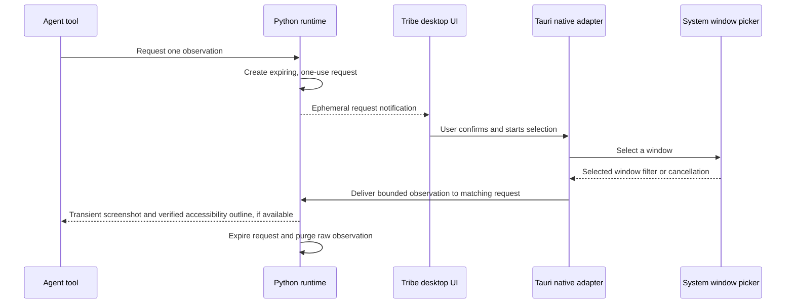

# Computer use capability design

## Recommendation

Treat computer use as a local, explicitly enabled capability with platform adapters. Keep it separate from browser automation: Playwright is the preferred surface for web pages; computer use is for native apps and UI that has no stable API or browser control surface.

Start with observe-only, then add a narrow set of actions behind exact-action approval. Do not expose arbitrary desktop input as a generic model tool. The first useful slice captures a bounded screenshot from a user-selected application/window and adds an accessibility outline only when the adapter can prove that the outline belongs to that exact selection. Later actions can target named controls, with coordinate actions as a visual fallback.

## Runtime boundary

```text
Agent worker
  └─ computer capability tools
       ├─ policy gate (scope, target, approval, timeout)
       ├─ single-machine interaction lease
       └─ platform adapter
            ├─ macOS: ScreenCaptureKit + Accessibility API
            └─ Windows: Windows.Graphics.Capture + UI Automation
```

The Python runtime owns policy, approval, event recording and Pydantic AI tool composition. A narrow native adapter owns OS capture, accessibility-tree inspection and input delivery. The adapter reports typed observations and action results; it does not call a model, decide policy or write mission events. Browser sessions continue through the existing Playwright MCP integration.

The native API surfaces are not equivalent. On macOS, ScreenCaptureKit's selected content filter exposes included `SCWindow` values with window IDs and owning applications. On Windows, the system picker returns a `GraphicsCaptureItem` whose documented public identity is its display name and size; UI Automation's `ElementFromHandle` requires an HWND. Do not join a Windows accessibility tree to a picked capture item by title or dimensions. The Windows adapter needs a verified identity bridge before it can return UIA data or enable named-control actions; until then, it may return a screenshot-only observation and must label accessibility as unavailable. [Apple SCContentFilter](https://developer.apple.com/documentation/screencapturekit/sccontentfilter), [Apple SCWindow](https://developer.apple.com/documentation/screencapturekit/scwindow), [Microsoft GraphicsCaptureItem](https://learn.microsoft.com/en-us/uwp/api/windows.graphics.capture.graphicscaptureitem), [Microsoft UI Automation ElementFromHandle](https://learn.microsoft.com/en-us/windows/win32/api/uiautomationclient/nf-uiautomationclient-iuiautomation-elementfromhandle)

The Windows picker has a separate limitation for the current observe-only contract: it permits selection of either an app window or a display and offers no mode filter. The returned item does not identify which was selected. Tribe therefore must not pass a Windows picker result to an agent unless a future adapter can prove it is a window; do not infer target type from the display name or dimensions. Keep WebView capture fail-closed on `displaySurface == "window"` until that identity gap is resolved. [Microsoft screen capture](https://learn.microsoft.com/en-us/windows/apps/develop/media-authoring-processing/screen-capture), [windows-capture picker API](https://docs.rs/windows-capture/latest/windows_capture/graphics_capture_picker/struct.GraphicsCapturePicker.html), [picked item API](https://docs.rs/windows-capture/latest/windows_capture/graphics_capture_picker/struct.PickedGraphicsCaptureItem.html)

## Adapter implementation direction

Keep the Python broker and policy path platform-neutral; put one-shot selection and frame conversion in small Tauri-native adapters behind an internal interface. The `screencapturekit` Rust crate exposes the macOS 14+ system picker, selected filter and screenshot APIs. The `windows-capture` crate wraps the Windows system picker and capture frames, but its picker result does not expose the selected target's HWND. Either crate can remove native plumbing, but each adapter still needs Tribe-owned cancellation, size limits, PNG encoding and transient-result handling. Before adopting them, verify licence, target toolchain, packaged-app entitlements, picker ownership and shutdown behavior in the actual macOS and Windows bundles. [screencapturekit picker API](https://docs.rs/screencapturekit/latest/screencapturekit/content_sharing_picker/struct.SCContentSharingPicker.html), [windows-capture picker API](https://docs.rs/windows-capture/latest/windows_capture/graphics_capture_picker/struct.GraphicsCapturePicker.html), [windows-capture source](https://docs.rs/windows-capture/latest/src/windows_capture/graphics_capture_picker.rs.html)

The Tauri shell currently exposes permission probes and settings navigation only. Agents run in the Python sidecar, so they cannot call Tauri commands directly. Stage 2 therefore needs an in-memory native request broker between an agent tool and the desktop shell; a capture button that is not connected to an agent request is not a deliverable.



The request registry is process memory, not a new SQLite table or event-log payload. A request is bound to its mission, requesting agent and expiry; its opaque response capability is one-use, and cancellation, timeout, mission pause, or app shutdown completes it without an observation. The native shell returns data only to the matching live request. The UI records a short user-readable status event after completion or cancellation, never screenshot bytes or accessibility text. This bridge is local to the current installation and does not depend on a remote service.

The runtime has an isolated in-memory broker with bounded capacity, expiry, one-time desktop claiming, one-use completion tokens, payload limits and cancellation. Local-origin routes expose pending request metadata and handle claim, completion and cancellation. Agents receive the `computer_observe` tool only when the user enables computer use for that project; disabling the setting, pausing or archiving a mission, stopping the run, expiry, or explicit cancellation purges the request and any unconsumed frame. Requested purpose and completion status are user-readable events; pixels and accessibility text never enter the event log.

The desktop UI polls the broker into the global **Needs you** queue. In the macOS desktop app, the user starts the native ScreenCaptureKit picker from the request dialog; the picker is restricted to one window and Tribe captures one bounded PNG from its returned filter. In the local browser preview and on Windows, the user starts `getDisplayMedia()` from the button; Tribe asks compatible pickers to exclude monitors, the current browser surface and source switching, then rejects the result unless the returned track reports `displaySurface == "window"`. These WebView options are hints and may be ignored, so the reported surface check remains mandatory. The native macOS path is compile-checked but still needs interaction testing in the packaged WKWebView app. The packaged Windows WebView2 path is not yet verified. Accessibility data and app input are not available. The image is sent directly to the waiting agent step and stays in live model memory; `TransientMediaStepStore` replaces its saved tool result with a text marker. The review dialog also lets the user explicitly save the PNG as a mission artifact; this creates a durable user artifact and does not share it with the waiting agent.

The user confirms every capture request in Tribe and selects the target through the OS picker. Capture never repeats in the background, changes target silently, or falls back to the whole desktop. The currently configured model provider receives the selected observation only for that request. The runtime must prevent raw pixels and accessibility text from entering durable event records, logs, telemetry, or Pydantic AI conversation snapshots; it purges its transient copy after the model step. Saving a screenshot as a mission artifact remains a separate, explicit user action; once saved, it follows the normal artifact retention and export rules.

## Interaction contract

1. The user enables computer use per project and selects the app/window scope. Permission status is explicit and revocable.
2. An agent requests an observation. Tribe returns a short-lived observation ID, selected-window metadata and screenshot reference. It includes an accessibility outline only when the platform adapter has verified that it belongs to the selected target. Large screen data is not copied into the event log or persisted agent history.
3. The agent proposes one typed action against that observation: target control and action where possible; coordinates only when no accessible target is available. The proposal includes a concise reason and expected result.
4. Tribe checks the observation is current, target stays within the selected window, policy permits the action and approval is satisfied. The UI shows the exact app/window, control, input and resulting external side effect before approval.
5. Tribe executes one discrete action, captures a fresh observation, and records the outcome. A user action, target-window change, timeout, pause or failed verification releases the machine lease and stops the sequence.

Only one agent may hold the local machine lease at a time. Other agents can work on repository tasks concurrently but cannot send competing input to the same desktop. An interrupted or restarted action is never replayed automatically when its outcome is unknown.

## Permission and data rules

- Screen capture and accessibility permissions are OS permissions, requested only after the user enables the feature. macOS ScreenCaptureKit requires screen-recording permission; its picker is the system-provided way to select capture sources. macOS Accessibility APIs expose accessible controls and actions but may report unsupported controls. [Apple ScreenCaptureKit](https://developer.apple.com/documentation/screencapturekit), [Apple AXUIElement](https://developer.apple.com/documentation/applicationservices/axuielement_h)
- Windows UI Automation is the primary control tree. Windows.Graphics.Capture provides app/window capture through system UI and displays an OS capture indicator. Synthetic keyboard/mouse input is a fallback, not the default. [Windows UI Automation](https://learn.microsoft.com/en-us/windows/win32/winauto/entry-uiauto-win32), [Windows screen capture](https://learn.microsoft.com/en-us/windows/apps/develop/media-authoring-processing/screen-capture), [SendInput](https://learn.microsoft.com/en-us/windows/win32/api/winuser/nf-winuser-sendinput)
- Capture only the selected window where supported. Never silently switch to full-desktop capture. No capture while Tribe is backgrounded unless the user explicitly starts an ongoing session.
- Screenshots and accessibility text can contain credentials, private messages or personal data. Keep raw observations in short-lived memory or permission-restricted temporary storage; do not retain them in telemetry, standard events or model history beyond the current step. Persist only bounded summaries and action metadata. Saving a screenshot as a mission artifact must be an explicit user action.
- Require individual approval for every concrete action. Do not add bulk approvals. Deny secure desktop, login/unlock, OS security prompts, credential entry and privileged system settings in the first release. Never ask the model to handle passwords or secrets.
- Actions can have effects outside Tribe and cannot be safely rolled back in general. Every action needs an expected-result check, a stop control and clear reporting when verification is inconclusive.

## Delivery stages

1. **Capability probe:** report real OS permission state without capture. The native probe checks macOS Screen Recording and Accessibility permissions, with Settings links to the corresponding privacy panes. On Windows, it checks whether Windows.Graphics.Capture is supported; a supported device still requires a user-selected window, and UI Automation has no general privacy prompt. The native interaction adapter remains unavailable, and UI Automation readiness must be checked for each selected target.
2. **Observe only:** complete the expiring agent-to-native request bridge; require a user-confirmed request and OS-selected window; return a screenshot to that agent step and an accessibility outline only where the exact target identity is verified; show a preview and explicit stop; prove that raw observations are purged and absent from durable history. Windows accessibility remains unavailable until the picker result can be safely bound to an HWND.
3. **Approved controls:** click/invoke, select, set visible text and scroll on named accessibility elements; one action per approval card; fresh observation after each action.
4. **Visual fallback:** coordinate click and keyboard input against a selected window only, with screenshot crop/coordinate overlay in the approval card.
5. **Hardening:** OS-specific UI tests, interrupted-action recovery, target-window race tests, permission revocation, display scaling/multi-monitor coverage and signed macOS/Windows packaging.

Do not start stage 3 until stage 2 has a permission review, security review and macOS + Windows acceptance tests. Avoid a cross-platform promise for controls that an application does not expose accessibly; use the visual fallback with explicit uncertainty.

Implementation update (26 October 2026): the observe-only UI shows a transient preview of the selected window and requires an explicit share action. Discarding it cancels the in-memory request and wakes the agent without returning image bytes. Four macOS native-shell unit tests pass for privacy settings links, permission/picker capability reporting and Windows capture-probe reporting. On this host, the test binary only starts when `DYLD_LIBRARY_PATH` includes Xcode's Swift 5.5 runtime; that workaround emits a duplicate Swift runtime class warning. Packaged macOS picker interaction and Windows WebView2 window reporting remain unverified; stage 3 is still gated on full stage 2 acceptance.

## Open engineering decisions

- Prototype the adapter boundary first on both target OSes. Keep native helpers replaceable; decide whether to package them inside the Tauri process or as signed sidecars only after confirming API coverage and packaging permissions.
- On Windows, first call `GraphicsCaptureSession.IsSupported()` and report unsupported hardware/OS separately from picker cancellation. Then use `GraphicsCapturePicker` associated with Tribe's native window handle; the system picker supplies the selected `GraphicsCaptureItem` and Windows draws a visible border while capture is active. The documented item exposes display name and size, while UI Automation needs an HWND; never guess a mapping or enumerate windows as a fallback. Ship screenshot-only observation until an identity bridge is proven. Validate the picker in Tribe's unpackaged development build and each shipped installer format. [Microsoft screen capture](https://learn.microsoft.com/en-us/windows/apps/develop/media-authoring-processing/screen-capture), [GraphicsCaptureItem](https://learn.microsoft.com/en-us/uwp/api/windows.graphics.capture.graphicscaptureitem), [ElementFromHandle](https://learn.microsoft.com/en-us/windows/win32/api/uiautomationclient/nf-uiautomationclient-iuiautomation-elementfromhandle)
- Treat Windows UI Automation readiness as target-specific. A global probe can only report that the API is present; it cannot promise that a selected app exposes a usable tree. Secure desktop and higher-integrity targets remain inaccessible under Tribe's normal privilege level; do not request UIAccess or elevation as a workaround. [Microsoft UI Automation](https://learn.microsoft.com/en-us/windows/win32/winauto/entry-uiauto-win32), [UI Automation security](https://learn.microsoft.com/en-us/windows/win32/winauto/uiauto-securityoverview)
- On macOS 14 and later, use ScreenCaptureKit's system content picker and retain the returned content filter; capture a single frame with `SCScreenshotManager` through that filter. Do not enumerate windows to recreate a picker selection. Keep the existing Screen Recording and Accessibility probes separate; confirm picker cancellation, permission revocation, and signed app identity in a packaged build. The system picker is Apple's recommended selection UI, and the screenshot manager supports one-frame capture from a filter. [Apple ScreenCaptureKit](https://developer.apple.com/documentation/screencapturekit), [capturing screen content on macOS](https://developer.apple.com/documentation/screencapturekit/capturing-screen-content-in-macos), [SCScreenshotManager](https://developer.apple.com/documentation/screencapturekit/scscreenshotmanager)
- Define the sidecar/native broker's cancellation, timeout, one-use response capability and shutdown semantics before exposing the agent tool. Test late, duplicate and cross-mission responses; none may complete a different or expired request.
- Verify the exact Pydantic AI message-snapshot path for image tool results. A screenshot must be stripped from persisted conversation state after the request's model step while retaining a concise text result; a passing native capture test alone does not prove transient retention.
- Stage 2 acceptance requires a packaged macOS app and each supported Windows installer to: show the OS selection/consent UI, capture only the chosen window, stop on cancellation or permission loss, keep frames transient, and return an explicit unsupported/error result without substituting whole-desktop capture. Add these acceptance checks before choosing a cross-platform capture dependency.
- Define capability results per platform rather than forcing a single permission checklist: macOS can preflight Screen Recording and Accessibility trust; Windows UI Automation is generally not a user-granted permission, while capture selection is mediated by the OS picker. Report unsupported, not-applicable, and unknown states distinctly.
- Establish precise policy categories for low-impact reversible actions versus actions that send, publish, delete, purchase, authenticate or modify system configuration. User policy already requires approval of each concrete action; no category may bypass a required approval.
- Define observation expiry and action idempotency. A screenshot reference must become unusable after a short TTL, and actions must carry an observation/version ID so stale coordinates or controls cannot be replayed.
- Measure memory and model-context cost before deciding how much screenshot, OCR or accessibility content can be retained per step.
