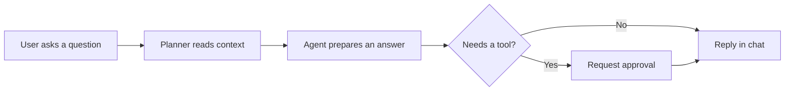
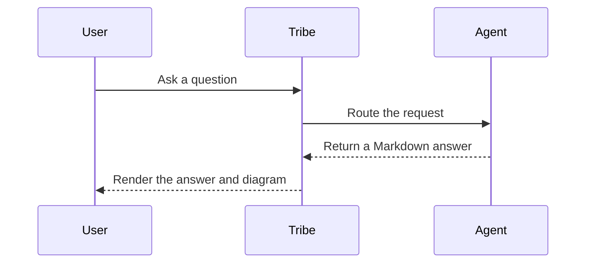

# Markdown response showcase

This fixture covers the Markdown forms agents commonly use in chat.

## Heading hierarchy

### Heading level 3

#### Heading level 4

##### Heading level 5

###### Heading level 6

Each heading level should remain clear without overpowering the response.

## Paragraphs and inline formatting

Keep answers concise. Use **bold** for emphasis, *italics* for titles, and `inline code` for commands, paths, and identifiers. Links should be readable: [Tribe project guidance](../AGENTS.md) stays in this workspace, while [the CommonMark reference](https://commonmark.org/) opens separately.

## Explicit line breaks

This reply keeps the author's line breaks.  
This sentence should appear on the next line in chat.

This soft-wrapped line
should continue as part of the same paragraph.

## Lists

- Unordered item
- Another item with **emphasis**
  - Nested item

1. First step
2. Second step
   1. Nested step

## Block quote

> A short quotation or cited passage should remain visually distinct.

## Horizontal rule

A divider should separate sections without touching the edge of the message column.

---

## Code

```python
def greet(name: str) -> str:
    return f"Hello, {name}!"
```

```typescript
type Greeting = { message: string };

const greet = (name: string): Greeting => ({ message: `Hello, ${name}!` });
```

```diff
diff --git a/src/greeting.ts b/src/greeting.ts
@@ -1,2 +1,3 @@
 export type Greeting = { message: string };
-export const greet = () => ({ message: "Hello" });
+export const greet = (name: string): Greeting => ({ message: `Hello, ${name}!` });
+export const farewell = (name: string): Greeting => ({ message: `Goodbye, ${name}.` });
```

## Mathematics

Inline maths should sit naturally in prose: $E = mc^2$.

Currency should stay as prose: $5 for a snack, or $10 for a meal.

Block maths should remain readable without widening the conversation:

$$
\int_0^1 x^2\,dx = \frac{1}{3}
$$

## GitHub Flavoured Markdown

| Check | Result |
| --- | --- |
| GFM table | Rendered |
| Strikethrough | ~~Not available~~ → Available |

- [x] Paragraphs and lists
- [x] Tables and task lists
- [ ] A deliberately incomplete item

Tables should preserve column alignment:

| Left aligned | Centred | Right aligned |
| :--- | :---: | ---: |
| Text | Text | 123.45 |
| Longer text | Text | 6.00 |

Bare links should remain clickable: https://example.com/docs and support@example.com.

## Mermaid diagram: flow



## Mermaid diagram: sequence


