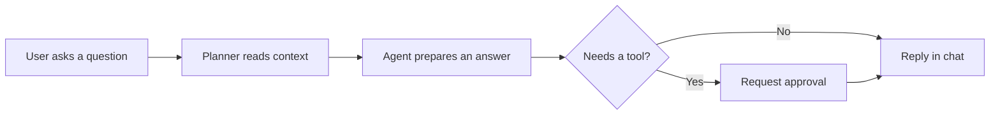
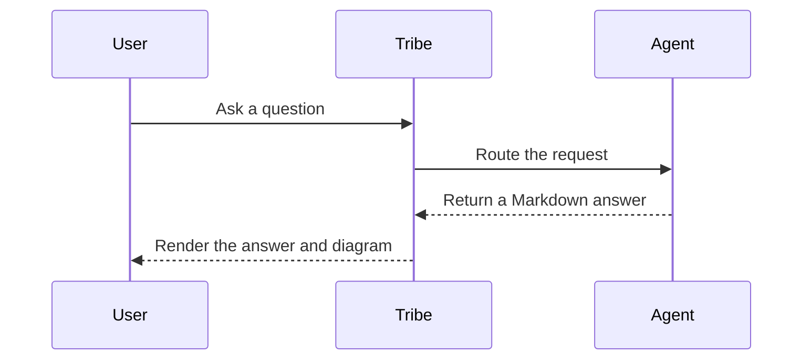

# Markdown response showcase

This fixture covers the Markdown forms agents commonly use in chat.

## Heading hierarchy

### Heading level 3

#### Heading level 4

##### Heading level 5

###### Heading level 6

Each heading level should remain clear without overpowering the response.

## Paragraphs and inline formatting

Keep answers concise. Use **bold** for emphasis, *italics* for titles, and `inline code` for commands, paths, and identifiers. Links should be readable: [Tribe project guidance](../AGENTS.md) stays in this workspace, while [the CommonMark reference](https://commonmark.org/) opens separately.

## Explicit line breaks

This reply keeps the author's line breaks.  
This sentence should appear on the next line in chat.

This soft-wrapped line
should continue as part of the same paragraph.

## Lists

- Unordered item
- Another item with **emphasis**
  - Nested item

1. First step
2. Second step
   1. Nested step

## Block quote

> A short quotation or cited passage should remain visually distinct.

## Horizontal rule

A divider should separate sections without touching the edge of the message column.

---

## Code

```python
def greet(name: str) -> str:
    return f"Hello, {name}!"
```

```typescript
type Greeting = { message: string };

const greet = (name: string): Greeting => ({ message: `Hello, ${name}!` });
```

```diff
diff --git a/src/greeting.ts b/src/greeting.ts
@@ -1,2 +1,3 @@
 export type Greeting = { message: string };
-export const greet = () => ({ message: "Hello" });
+export const greet = (name: string): Greeting => ({ message: `Hello, ${name}!` });
+export const farewell = (name: string): Greeting => ({ message: `Goodbye, ${name}.` });
```

## Mathematics

Inline maths should sit naturally in prose: $E = mc^2$.

Currency should stay as prose: $5 for a snack, or $10 for a meal.

Block maths should remain readable without widening the conversation:

$$
\int_0^1 x^2\,dx = \frac{1}{3}
$$

## GitHub Flavoured Markdown

| Check | Result |
| --- | --- |
| GFM table | Rendered |
| Strikethrough | ~~Not available~~ → Available |

- [x] Paragraphs and lists
- [x] Tables and task lists
- [ ] A deliberately incomplete item

Tables should preserve column alignment:

| Left aligned | Centred | Right aligned |
| :--- | :---: | ---: |
| Text | Text | 123.45 |
| Longer text | Text | 6.00 |

## Bar chart

Bars compare values across a small set of categories.

```chart
{
  "type": "bar",
  "title": "Support requests by topic",
  "xLabel": "Topic",
  "yLabel": "Requests",
  "data": [
    { "x": "Billing", "y": 38 },
    { "x": "Setup", "y": 31 },
    { "x": "Access", "y": 24 },
    { "x": "Other", "y": 12 }
  ]
}
```

## Line chart

Lines make changes over ordered time points easy to compare.

```chart
{
  "type": "line",
  "title": "Weekly active users",
  "xLabel": "Week",
  "yLabel": "Users (thousands)",
  "data": [
    { "x": "Week 1", "y": 8.2 },
    { "x": "Week 2", "y": 8.8 },
    { "x": "Week 3", "y": 8.5 },
    { "x": "Week 4", "y": 9.4 },
    { "x": "Week 5", "y": 10.1 }
  ]
}
```

## Area chart

An area chart emphasises the volume beneath a time trend.

```chart
{
  "type": "area",
  "title": "Monthly support volume",
  "xLabel": "Month",
  "yLabel": "Tickets",
  "data": [
    { "x": "Jan", "y": 420 },
    { "x": "Feb", "y": 390 },
    { "x": "Mar", "y": 510 },
    { "x": "Apr", "y": 470 },
    { "x": "May", "y": 560 }
  ]
}
```

## Pie chart

Pie charts show each category's share of a whole.

```chart
{
  "type": "pie",
  "title": "Release feedback",
  "data": [
    { "label": "Positive", "value": 64 },
    { "label": "Mixed", "value": 25 },
    { "label": "Negative", "value": 11 }
  ]
}
```

## Scatter chart

Scatter plots reveal relationships between two numeric measures.

```chart
{
  "type": "scatter",
  "title": "Latency and request volume",
  "xLabel": "Requests per second",
  "yLabel": "Latency (ms)",
  "data": [
    { "x": 10, "y": 82 },
    { "x": 20, "y": 95 },
    { "x": 30, "y": 121 },
    { "x": 40, "y": 146 },
    { "x": 50, "y": 188 }
  ]
}
```

## Histogram

Histograms show the distribution of values across bins.

```chart
{
  "type": "histogram",
  "title": "Build duration distribution",
  "xLabel": "Duration (minutes)",
  "yLabel": "Builds",
  "data": [
    { "x": "0–2", "y": 18 },
    { "x": "2–4", "y": 32 },
    { "x": "4–6", "y": 24 },
    { "x": "6–8", "y": 10 },
    { "x": "8+", "y": 4 }
  ]
}
```

## Box plot

Box plots compare medians, spread and range without exposing every observation.

```chart
{
  "type": "boxplot",
  "title": "Resolution time by team",
  "data": [
    { "label": "Platform", "min": 1, "q1": 3, "median": 5, "q3": 8, "max": 14 },
    { "label": "Product", "min": 2, "q1": 4, "median": 6, "q3": 9, "max": 16 },
    { "label": "Support", "min": 1, "q1": 2, "median": 4, "q3": 7, "max": 12 }
  ]
}
```

## Heatmap

Heatmaps compare values across two category axes.

```chart
{
  "type": "heatmap",
  "title": "Incidents by day and shift",
  "xLabel": "Day",
  "yLabel": "Shift",
  "data": [
    { "x": "Mon", "y": "Morning", "value": 7 },
    { "x": "Tue", "y": "Morning", "value": 4 },
    { "x": "Wed", "y": "Morning", "value": 9 },
    { "x": "Mon", "y": "Evening", "value": 3 },
    { "x": "Tue", "y": "Evening", "value": 6 },
    { "x": "Wed", "y": "Evening", "value": 2 }
  ]
}
```

## Horizontal bar chart

Long category names should remain readable beside their values.

```chart
{
  "type": "horizontal-bar",
  "title": "Highest priority themes",
  "xLabel": "Responses",
  "data": [
    { "x": "Reduce onboarding time", "y": 42 },
    { "x": "Improve reporting clarity", "y": 35 },
    { "x": "Simplify team setup", "y": 27 }
  ]
}
```

## Stacked bar chart

Stacked bars show both category totals and how each total is composed.

```chart
{
  "type": "stacked-bar",
  "title": "Quarterly revenue by product line",
  "xLabel": "Quarter",
  "yLabel": "Revenue ($k)",
  "series": [
    {
      "name": "Core",
      "data": [
        { "x": "Q1", "y": 420 },
        { "x": "Q2", "y": 460 },
        { "x": "Q3", "y": 490 },
        { "x": "Q4", "y": 530 }
      ]
    },
    {
      "name": "Services",
      "data": [
        { "x": "Q1", "y": 160 },
        { "x": "Q2", "y": 175 },
        { "x": "Q3", "y": 195 },
        { "x": "Q4", "y": 210 }
      ]
    },
    {
      "name": "Add-ons",
      "data": [
        { "x": "Q1", "y": 85 },
        { "x": "Q2", "y": 96 },
        { "x": "Q3", "y": 112 },
        { "x": "Q4", "y": 128 }
      ]
    }
  ]
}
```

## 100% stacked bar chart

Normalised stacks compare category mix when the category totals vary.

```chart
{
  "type": "percent-stacked-bar",
  "title": "Revenue mix by quarter",
  "xLabel": "Quarter",
  "yLabel": "Share of quarterly revenue (%)",
  "series": [
    {
      "name": "Core",
      "data": [
        { "x": "Q1", "y": 500 },
        { "x": "Q2", "y": 800 },
        { "x": "Q3", "y": 1200 },
        { "x": "Q4", "y": 1600 }
      ]
    },
    {
      "name": "Services",
      "data": [
        { "x": "Q1", "y": 250 },
        { "x": "Q2", "y": 600 },
        { "x": "Q3", "y": 900 },
        { "x": "Q4", "y": 1200 }
      ]
    },
    {
      "name": "Add-ons",
      "data": [
        { "x": "Q1", "y": 250 },
        { "x": "Q2", "y": 600 },
        { "x": "Q3", "y": 900 },
        { "x": "Q4", "y": 1200 }
      ]
    }
  ]
}
```

## Funnel chart

Funnel stages show the remaining count and conversion at each step.

```chart
{
  "type": "funnel",
  "title": "Product checkout conversion",
  "data": [
    { "label": "Product page visits", "value": 10000 },
    { "label": "Added to cart", "value": 5200 },
    { "label": "Started checkout", "value": 1800 },
    { "label": "Entered delivery details", "value": 1200 },
    { "label": "Completed purchase", "value": 860 }
  ]
}
```

## Bubble chart

Bubble area compares a third numeric measure while colour groups each segment.

```chart
{
  "type": "bubble",
  "title": "Product segment performance",
  "xLabel": "Monthly active users (thousands)",
  "yLabel": "Conversion rate (%)",
  "sizeLabel": "Monthly revenue ($k)",
  "data": [
    { "x": 14, "y": 3.2, "size": 24, "label": "Starter", "series": "Self-serve" },
    { "x": 31, "y": 4.1, "size": 68, "label": "Team", "series": "Self-serve" },
    { "x": 22, "y": 5.4, "size": 91, "label": "Growth", "series": "Sales-led" },
    { "x": 39, "y": 6.1, "size": 146, "label": "Enterprise", "series": "Sales-led" }
  ]
}
```

## Waterfall chart

Changes connect from the previous running total; total steps show an absolute balance.

```chart
{
  "type": "waterfall",
  "title": "Quarterly revenue bridge",
  "xLabel": "Revenue movement",
  "yLabel": "Revenue ($k)",
  "data": [
    { "label": "Opening", "value": 820, "type": "total" },
    { "label": "New sales", "value": 115 },
    { "label": "Expansion", "value": 62 },
    { "label": "Churn", "value": -94 },
    { "label": "Discounts", "value": -28 },
    { "label": "Closing", "value": 875, "type": "total" }
  ]
}
```

## Treemap

Rectangle area shows relative cost; colour partitions the items by product area.

```chart
{
  "type": "treemap",
  "title": "Monthly cloud spend by service",
  "data": [
    { "label": "Compute", "value": 4200, "group": "Platform" },
    { "label": "Database", "value": 2600, "group": "Platform" },
    { "label": "Storage", "value": 1350, "group": "Platform" },
    { "label": "Monitoring", "value": 780, "group": "Platform" },
    { "label": "Search ads", "value": 1900, "group": "Growth" },
    { "label": "Email delivery", "value": 950, "group": "Growth" },
    { "label": "Analytics", "value": 640, "group": "Growth" }
  ]
}
```

## Radar chart

Radar charts compare named options across the same criteria, using one shared scale.

```chart
{
  "type": "radar",
  "title": "Project management tools",
  "maxValue": 5,
  "series": [
    {
      "name": "Tribe",
      "data": [
        { "x": "Ease of setup", "y": 4.4 },
        { "x": "Team workflows", "y": 4.7 },
        { "x": "Reporting", "y": 4.1 },
        { "x": "Customisation", "y": 4.5 },
        { "x": "Value", "y": 4.2 }
      ]
    },
    {
      "name": "Alternative",
      "data": [
        { "x": "Ease of setup", "y": 4.1 },
        { "x": "Team workflows", "y": 3.8 },
        { "x": "Reporting", "y": 4.6 },
        { "x": "Customisation", "y": 3.7 },
        { "x": "Value", "y": 4.0 }
      ]
    }
  ]
}
```

Bare links should remain clickable: https://example.com/docs and support@example.com.

## Mermaid diagram: flow



## Mermaid diagram: sequence


