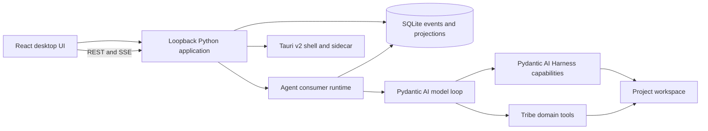

# Tribe capability roadmap

The target is Sarathi-level breadth with a more durable event model, composable runtime, and clearer desktop workflow. This ledger prevents prototype features from being mistaken for product parity.

Use [product benchmark references](product-benchmarks.md) for the distinction between UX/feature benchmarks and Tribe's model-provider runtime boundary. This roadmap remains authoritative for implementation status.

## Current boundary

Pydantic AI/Harness owns standard model, tool, workspace, skill, MCP, and capability composition. Tribe owns durable projects and missions, event delivery, role consumers, the agent-maintained plan, approval decisions, repository policy, and UI projections. No Pydantic `Coder` or `SubAgents` composition may silently delegate work outside the shared event channel.

Model setup passes each saved key directly to that run's Pydantic AI provider instance, avoiding process-wide credential swaps between concurrent agents. The Settings form accepts additional Pydantic AI provider IDs; Pydantic AI's `litellm:` provider connects to an existing LiteLLM proxy without adding the LiteLLM SDK to Tribe. Providers requiring multi-part cloud credentials or interactive account setup still need dedicated setup flows.

## Capability ledger

| Capability | Tribe today | Target and implementation boundary |
| --- | --- | --- |
| Interactive responses | Partial | Projects can opt in (off by default) to inline, self-contained HTML apps created by agents; ordinary answers stay Markdown. Apps run in a sandboxed opaque-origin iframe with a restrictive CSP, no same-origin access, storage, popups, forms, top navigation, remote subresources or app network requests. Results remain local until the user explicitly shares them; the durable action is routed only to a role selected for that project. Turning the project option off stops and hides apps. A script can still navigate its own frame to a remote site, so sensitive data must not be embedded. Remaining: typed built-in blocks for common choices/forms/charts, stronger native WebView egress enforcement, and provider-backed packaged acceptance. |
| Projects, missions, shared channel, task board | Implemented | SQLite events remain authoritative; project goals remain user-owned summaries and can link up to ten validated repository Markdown/text files as live agent context, with each change recorded in the mission channel. Settings exports a portable workspace backup containing consistent snapshots of the event database and Pydantic AI conversation state plus shared artifact files, while excluding repository files and OS credentials. Restore validates and stages an imported backup, requires all missions, agents, commands and schedules to be idle, then activates it on the next runtime launch; it preserves the device's agent roles, workflows and MCP definitions and retains one rollback copy. A versioned, project-scoped JSON audit contains mission events and artifact metadata without file contents. The project explorer searches project/mission names and opens a bounded, read-only repository browser with UTF-8 previews. Paused or completed missions can be archived without deleting history or files, then restored to their previous status; active missions, pending requests, running agents and commands block archival. Archived missions are hidden from the active project list and read-only until restored. Event replay and project lifecycle controls remain. |
| Chats without a project | Runtime/UI vertical slice implemented; isolated development UI acceptance passed; packaged UI acceptance pending | General chats have separate durable history and a provider-backed assistant with a narrow workspace web-search allowlist; project skills, workflows, repository, memory, MCP, artifact, command, schedule and computer tools are excluded. Deep Research is an explicit per-turn composer mode, persists its mode, asks for a structured source-backed report, renders provider citations as titled links with publisher domains, and uses the existing chart Markdown format when useful. Its progress label reflects the active provider request. Web search must be enabled by the workspace preference. Ordinary chat stays on the existing path. Each chat can select an allowed tool-capable model or follow the workspace default; the choice is validated, persisted and used for replies. Runtime tests cover the exact safe tool set, citation validation and persisted replies; UI coverage checks the no-project scope. Remaining: live-provider quality evaluation, packaged UI acceptance, and a chat-isolated workspace-safe research team/shared-document path if it can preserve the no-local-access boundary. |
| Non-Git and greenfield projects | Runtime/native picker acceptance and isolated release app/sidecar startup passed; packaged project setup interaction pending | Project registration and creation accept an existing local folder without Git, including an empty folder; Git roots still resolve to their repository top level. Runtime acceptance verifies agent file creation and Harness filesystem/shell capabilities use the greenfield folder, while Git diff and isolated work report their Git requirement. The current bundled arm64 sidecar registered an empty folder, and `/api/projects/{id}/git` returned `isGit:false` in its isolated profile. A macOS Tauri debug app bundle opened the native picker, selected a newly created empty folder, and returned its path and derived project name to setup; the unsubmitted draft was discarded. The release `.app` and runtime sidecar both built. A DMG containing that app was produced without Finder layout automation and passed `hdiutil verify`. A separately configured release `.app` (isolated bundle ID and port) now builds and opens with a healthy bundled sidecar, showing the empty-workspace screen and the copy that permits an empty folder. Repository uses the selected non-Git folder and Git Changes is omitted from the chat views menu. Code review confirms repository browsing and ordinary file/shell work use the selected folder, Git status/diff report the non-Git state, and isolated work/integration are the only Git-bound operations. Runtime tests cover these boundaries. Remaining: packaged project setup interaction. The default DMG layout step currently fails when its Finder AppleScript times out in this environment. |
| Goal-driven SDLC | Partial | The planner, builder and reviewer follow a staged discovery → implementation → verification → independent review → fix/re-verify protocol. Agents inspect the board and must claim a chosen eligible item by its exact ID, allowing role-fit selection instead of hidden FIFO assignment; prerequisites, mission scope, one active claim per role and lease ownership remain enforced by the store. The board shows blockers. The planner commits the plan and acceptance criteria through a durable event checkpoint, mapping every criterion to its delivery tasks and every task to at least one criterion; the mission channel exposes that mapping. Adding or revising a task invalidates the checkpoint. Repository actions and reviewer checkpoints require the current finalized plan, and completion criteria must exactly match that checkpoint. Repository edits, test runs, deletions and isolated-work integration through Tribe's workspace tools require the acting role to hold a live plan-item claim; Harness file-write and shell hooks enforce the same gate. Reviewer-only mission completion requires all work done, a completed reviewer-owned item, no pending user requests, a summary and acceptance evidence. Every acceptance check now maps to one or more durable successful-run or mission-artifact IDs; the channel displays each mapping and links artifacts. Goal-driven missions persist reviewer checkpoints bound to the latest repository change and require the most recent test run to pass; a newer failed run returns the mission to verification and prevents review or completion from reusing stale passing evidence. Structured findings appear in the channel. A changes-requested checkpoint creates one ready plan item per finding, waking role consumers through the existing plan-event path. Completion requires an approved checkpoint and cited current test evidence. Later changes or test runs invalidate earlier review checkpoints. Review checkpoints are rejected while any current plan item remains unfinished; a changes-requested checkpoint creates new work for the next review cycle. A pending request automatically marks a mission blocked when no plan work is ready or claimed; agents can also persist a specific blocked reason, cleared when all requests resolve. Discovery and implementation entry criteria are still guided by recipe instructions rather than separate durable phase gates. |
| Agent roles and autonomous event consumers | Implemented | Markdown roles can select an optional Pydantic AI model override and repository access (`read_only` or `workspace_write`). Planner and reviewer roles have read-only repository tools; builder roles can edit. The read-only boundary removes write-capable Tribe and Harness tools and filters MCP tools to server-declared read-only entries. Each role resolves provider credentials independently, and a provider setup failure is surfaced without blocking other consumers. Reviewer wake-up filters now use completed work milestones and explicit artifact/Canvas review requests, rather than starting a run for every file edit, successful test event or artifact creation. SQLite now grants an atomic single-owner claim per role, mission and trigger event; duplicate consumers wait without invoking a provider or advancing their cursor. A replacement consumer quarantines a run left active by a dead worker, records unknown tool outcomes and releases work claims instead of silently replaying side effects. |
| Repository reads, edits, tests, path locks, isolated worktrees | Implemented; execution sandbox not implemented | Use Harness filesystem and shell primitives where they preserve Tribe path locking, change events, and approval policy. Harness file locks now leave the event loop unblocked while waiting, release immediately after the completed write event, and remove idle in-process lock entries; OS file locks continue to serialize separate runtimes. Goal-driven SDLC actions through Tribe workspace tools and Harness file-write or shell tools must carry a live claimed plan item. Detached Git worktrees isolate changes from the shared checkout, but allowed shell processes are not OS-contained. Evaluate Pydantic AI Harness `DockerSandbox` only with a unified workspace backend that preserves locks, change events, approvals and patch review; see [`workspace-isolation-design.md`](workspace-isolation-design.md). |
| User-launched background commands | Implemented with built-in and project-scoped allowlists | Exact command arguments run in the selected project's Git root; native executables use direct process launch, Windows `.cmd`/`.bat` wrappers use a bounded control-character check and argument quoting, and POSIX commands avoid shell expansion. The default covers common JavaScript/TypeScript, Python, compiled-language, build, version-control and container tools. Users can add project-scoped executable names in Settings; each change is validated, persisted and audited. Launch revalidates the project's current policy and resolves the executable before starting. Command status, bounded output and start/finish events persist per mission, restore into the mission view after reload, and refresh from live events. Normal desktop exit requests graceful runtime shutdown; the runner terminates command process trees and records cancellation before the sidecar exits. On an unclean restart, remaining `running` rows become `interrupted` with one durable completion event; Tribe does not relaunch commands or infer their exit result, and partial output remains available. Windows wrapper construction and desktop shutdown have host-independent/runtime integration coverage. |
| Skills from project and user directories | Implemented | Discover portable `SKILL.md` packages from Agent Skills, Claude, Codex, GitHub Copilot, Cursor, Gemini CLI and OpenCode project/user locations, plus Claude/Codex plugin caches. Search nested project scopes while skipping dependency/build trees; honour `AGENT_SKILLS_PATHS` and Copilot's `COPILOT_SKILLS_DIRS`. Name collisions use the first project-to-user root in deterministic precedence order. On POSIX, Pydantic AI Harness receives only canonical skill names at its configured library depth that match its Agent Skills validation; Tribe's compatibility search/read tools continue to expose every discovered skill and safe text resource, including nested and noncanonical ecosystem packages on every platform. Windows omits Harness local-workspace capabilities because their backend is POSIX-only. Behavioral front matter unsupported by Pydantic AI Harness (for example, `allowed-tools`) is not enforced and cannot override Tribe's role permissions. Skill scripts remain available as instructions/resources but are not executed. |
| Exact approvals and clarification requests | Implemented | Deferred Shell approvals persist the exact Pydantic message frontier and tool call atomically with the request. Restart resumes that call; if an approved side effect has an unknown outcome, automatic replay stops and the run needs attention. Repository deletion approvals bind to the requested file's SHA-256 and atomically record approval consumption, operation state, deletion start and a bounded pending review diff; changed files fail closed without consuming the approval. Startup reconciliation confirms an absent target, identifies an unchanged target that needs fresh approval, or surfaces changed/unverifiable state for review; it never retries unlinking. A confirmed deletion publishes its saved diff idempotently after restart. Binary files and files over the diff snapshot limit complete without a diff artifact and are labelled accordingly. |
| Artifacts, project knowledge, real-time activity UI | Partial | File and command tool start/finish events coalesce into one live timeline row, including across history pages. Agent lanes filter activity; project artifacts are searchable. File outputs have durable review threads and agent review tools. Harness folder creation is recorded as a repository change and releases its path lock as soon as the directory event arrives; activity labels distinguish created files and folders from edits. Users can create collaborative Canvas documents from Artifacts; Canvas supports Markdown, text, code and Mermaid diagram kinds, immutable revisions, user edits, agent proposals, stale-base protection, accept/dismiss, selected-text comments, replies, resolution and assignee-directed agent wake-ups. Canvas publications are captured atomically with channel messages and hidden from prose. These documents coexist with binary/test/diff artifacts in project storage. A user may explicitly save a reviewed computer-use screenshot as a mission image artifact without sharing it with the requesting agent; sharing remains a separate decision. Proposal reviews show bounded line diffs and let users accept selected change groups; oversized proposals show a full-document comparison and require full-revision acceptance. A user can start a mission discussion from a saved document revision, attach a selected passage, and reopen that exact revision from the channel; agents are instructed to read the referenced revision. Discussion opens the document beside the mission channel so users can edit/review while following agent activity and concrete requests. Mission owners can explicitly link a project document into another mission without copying it; the linked mission sees the canonical version history while proposals and comment threads stay scoped to their mission. Users can unlink a document and access is revoked there. Local drafts survive editor reopen with their original base revision, stale drafts are identified and protected by revision checks, and users can explicitly keep, discard or download recovered drafts. Canvas content and historical revisions can be downloaded with safe filenames and type-appropriate extensions; Mermaid diagrams can also be exported as standalone SVG files. Remaining: visual browser/desktop acceptance. |
| Providers | Partial | Tribe delegates model resolution to Pydantic AI's `provider:model` identifiers; direct API-key setup now covers OpenAI, Anthropic, Google Gemini, Groq, Mistral, DeepSeek, OpenRouter, xAI, Cerebras, Cohere, Fireworks, Together AI and Ollama, using each provider's environment-variable convention and OS keychain storage. Any Pydantic AI provider whose constructor supports a custom service URL can now use an explicitly configured endpoint without a saved key, rather than relying on a Tribe-maintained provider allowlist. Custom OpenAI-compatible endpoints also support a LiteLLM proxy or other compatible gateway without a Tribe-specific adapter. Completed runs persist reported requests, token/cache counts and Pydantic AI's best-effort USD estimates, shown by project/model/agent. The local runtime refreshes Pydantic AI price data in the background on startup and hourly. Users can set a per-agent-run USD estimate ceiling; Pydantic AI enforces it when the model price and usage are known. Unknown-price runs remain uncapped, and the response that crosses a ceiling may already be billed. Settings has a user-triggered, bounded provider check that offers one harmless in-memory tool and reports connectivity separately from tool-calling capability; this may take up to two model requests. A live check on `ollama:qwen2.5-coder:7b` returned `connected: true` and `toolCalling: false`, so that model is reachable but not verified for autonomous tool use. Coding-agent harnesses such as Codex and Claude are usability and feature benchmarks, not Tribe model-provider backends. Settings can discover installed Ollama models through a bounded request to the fixed loopback Ollama endpoint; selection still requires the user to save the model. Ollama token limits are checked from provider-reported usage after each response because it does not support the pre-request counting pass; this allows one oversized request. Monthly usage and USD estimate aggregation are implemented; billing reconciliation and billing-grade provider limits remain. |
| MCP and service connections | Implemented for stdio, HTTP, no-auth, header-token and browser OAuth; OAuth acceptance partial | Project-scoped standard `mcpServers` JSON is stored with user-only permissions; Pydantic AI loads stdio and HTTP toolsets. Settings offers a first-party remote service form for HTTPS or loopback HTTP with no-auth, header-token credentials saved to the OS keychain, or explicit browser OAuth sign-in. The advanced JSON editor retains stdio and protocol-specific configuration. Credentials are environment references or keychain entries; non-read-only calls use durable exact-call approval/resume, and tool activity is recorded in the mission stream. Settings checks each server through Pydantic AI's MCP client, lists advertised tools, and persists per-server and per-tool disable controls enforced when toolsets are built. OAuth token and client registration data are scoped to workspace, project, service and endpoint. Refresh is coordinated across threads/processes; tests cover authorization-code/PKCE sign-in against a local test server and tool discovery, read-only invocation, and agent approval/resume through an OAuth-protected MCP SDK server. A real external OAuth service and packaged callback acceptance remain; see [`mcp-connectors-design.md`](mcp-connectors-design.md). |
| Browser and web research | Deep Research entry point implemented across both chat scopes; project team, approvals and citations wired; embedded desktop engine proof in progress | Deep Research is opt-in per turn. Project chats use the Planner as research lead, carry Deep Research context through durable plan tasks, and offer reusable Researcher and Evidence reviewer role templates with web, shared-artifact and task-coordination grants; task creation and revision reject unready roles and missing research grants with recovery choices. The lead protocol frames questions, delegates focused first-round work, creates a dependent Planner analysis task, refines questions as evidence arrives, assigns focused follow-up work, verifies consequential claims against source pages, and schedules final report synthesis after assigned research and source-audit tasks. This remains provider-driven guidance over existing role consumers, plans and artifacts; live-provider quality and completion behaviour still need acceptance. The Planner receives the research intent and existing team/workflow context; work remains governed by selected roles, project grants, web settings, exact approvals and hostname allowlists. Projectless research uses its isolated workspace search agent and cannot access local skills, files, repositories, shell, computer, team or workflow capabilities; workspace web search must be enabled. Any future projectless research team or shared documents must be chat-isolated and workspace-safe. Both modes ask for evidence-backed reports with clickable citations; the existing chart renderer handles useful structured data. Projectless provider citations are persisted structurally; project-chat citations are presented as inline Markdown links and a titled source list. The existing Playwright MCP path remains isolated and approval-gated. A separate Electron worktree embeds real pages in `WebContentsView`; the desktop development build passed live navigation, site input, random generation, shade rendering, and iPhone emulation against UI Colors. A token-authenticated loopback service and deferred Browser capability connect agents to the chat-scoped visible page, subject to project hostname allowlists. This development proof is not packaged or released. Remaining: validate iterative research coordination and report quality with live providers, verify shared-document and artifact use through complete team runs, safe projectless collaboration boundaries, exercise agent controls against the embedded page, enforce sensitive-action approvals and redirect/egress policy, add named profiles, tabs/pop-ups, permission and upload management, diagnostics, and replace Tauri bridges and packaging across supported platforms. See [`browser-workbench-design.md`](browser-workbench-design.md). |
| Computer use | Observe-only vertical slice implemented; packaged desktop acceptance remains open | A project opt-in exposes the `computer_observe` agent tool. The runtime broker issues bounded, expiring requests; the **Needs you** queue shows a transient screenshot preview and requires an explicit share action before returning one PNG frame to the waiting agent step. From that preview, the user may separately save the image as a mission artifact; it is never saved automatically. Discard cancels the request without returning image bytes. On macOS 14+, the Tauri command uses ScreenCaptureKit's system picker configured for exactly one window and captures from that returned filter. In the browser preview and on Windows, `getDisplayMedia()` requests window selection, hints that monitors and the current browser surface should be excluded, and fails closed unless the returned track reports `displaySurface == "window"`. Screenshot bytes stay out of event records and saved conversation snapshots unless the user explicitly saves an artifact; the agent tool receives them transiently. No accessibility outline, app input or background capture is available. The macOS adapter has passed host compilation but needs interaction acceptance in the packaged app; WebView2 selection and reporting remain unverified. The Windows native picker is not used because `GraphicsCaptureItem` does not provide the HWND required to verify a window identity for UI Automation. Browser automation remains a separate Playwright MCP capability. See [`computer-use-design.md`](computer-use-design.md). |
| Dynamic and/or sub-agents | Backlog; fit assessment required | See [`subagent-delegation-backlog.md`](subagent-delegation-backlog.md). First compare Pydantic AI's current delegation primitives with Tribe's durable role-consumer/event-channel model and validate concrete use cases. Do not add agent spawning until the fit and ownership model are decided. Keep it separate from distributed collaboration. |
| Distributed Tribe collaboration | Enterprise backlog; no implementation | See [`distributed-collaboration-backlog.md`](distributed-collaboration-backlog.md). Separate enterprise licence; hosted and self-hosted relay options; mission-scoped invitations; durable canonical event sync and relay-issued fenced task leases. Agents and repositories remain on each participant's machine, with local approval for local side effects and explicit publication for shared artifacts. Peer-to-peer-only transport and shared checkouts are out of scope. Requires an ADR, threat model, licensing and offline semantics, then two-replica failure/recovery acceptance before implementation. |
| Durable memory and learning | Smriti-backed project wrapper, conflict review and verified legacy retirement implemented; bundled sidecar write/read acceptance passed | The project wrapper binds IDs and queries to the selected project, writes accepted memories to Smriti, and keeps agent proposals in a user-reviewed queue. Startup performs an idempotent migration of accepted legacy memories across all projects before active chats resume, audits missing entries and field conflicts, then records source fingerprints in a hash-only ledger and clears verified legacy content. Unresolved entries remain available for review. Proposal decisions, conflict resolutions and mission events remain durable. Project settings compare conflicting current and previously saved versions and record a choice against fingerprints of both exact versions; later changes reopen review while the legacy source is retained. Conflicts whose Smriti record belongs to another project stay hidden and cannot be moved or replaced from the current project. Users can explicitly copy the previously saved version under a new project-scoped identifier; migration retires the old source only after verifying that copy, preserving the foreign record. Focused coverage exercises project scope, proposal review, migration, retirement, conflict history, schema upgrade and API paths. The live local workspace audit covered 10 projects; its one accepted legacy memory was verified, then retired into the hash ledger (1 ledger entry, 0 legacy rows, 0 missing entries or conflicts). The current bundled arm64 sidecar created an empty non-Git project, saved a memory through the project API, returned it on bootstrap, and wrote a Markdown record whose `tribe_project_id` matched that project; health and graceful shutdown passed in an isolated temporary profile, which was removed. Remaining: packaged UI migration/proposal acceptance. |
| Recipes and reusable workflows | First vertical slice implemented | Markdown recipes have validated front matter, built-in defaults and user overrides. The goal-driven SDLC recipe is selected by default for first and later missions; users can change it, create/version recipes, inspect them in the Workflows tab and select another workflow. Its immutable version snapshot is stored on the mission and included in each agent's context as advisory guidance. General workflow graphs, pause/resume checkpoints and recipe-specific recovery remain. |
| Scheduling | Local project schedules, custom cron recurrence, existing-chat targets and durable invocation delivery implemented | Durable schedules create background chats with hourly, daily, weekday, weekly, monthly-on-the-first, one-off, or custom five-field cron recurrence. Cron supports lists, ranges, steps, month and weekday names, standard day-of-month/day-of-week matching, and an IANA timezone; invalid or non-occurring expressions are rejected, and DST gaps are skipped. Users can pause, resume, run now, cancel, edit and inspect paginated history from project settings or the workspace Scheduled tasks view. The workspace view identifies each schedule's project and uses project-scoped create/edit/run operations. Editing is rejected while a scheduled chat is running, paused or waiting for input; failed one-off schedules can be edited or retried. Deferred list/create/edit/manage tools remain available only to roles explicitly granted the project-scoped scheduling capability; agent-created schedules default to the runtime device's IANA timezone (including Windows through the locked `tzlocal` provider), and edits preserve the existing timezone unless changed. The open app polls for scheduled chat completion, failure or a need for user input and shows one in-app notice for each outcome without replaying the initial history snapshot; new terminal runs are now detected even if they start and finish between polls. In the desktop app, users may opt in to native notifications; the app sends them only while unfocused and only when operating-system permission is already granted. Notification dispatch awaits the native API so async failures reach the fallback handler. Terminal agent failures settle the linked scheduled invocation with a safe error; one-off schedules stop re-queuing and expose Retry now. Execution stays local, and restart recovery coalesces missed intervals into one run. Runtime tests cover timezone defaults, platform-provider fallback, overdue recovery, workspace aggregation, outcome notices, cron parsing and recurrence, expression persistence, API routes and schema migration. The rebuilt arm64 app passed the packaged launch and clean-shutdown check; its sidecar accepted a custom cron schedule in isolated storage and returned the expected Monday 09:00 Australia/Sydney occurrence. The freshly rebuilt sidecar also persisted a daily Australia/Sydney schedule and returned it from the workspace list. A separately configured release app now launches with a healthy sidecar and displays the Scheduled tasks workspace destination; schedule form interaction remains unverified in that app. Scheduled prompts are committed with their event and a queued run record that stores the exact trigger sequence. Agent startup changes that record to running atomically with its event claim; queued chats are retried on scheduler polls and after restart, and chat lifecycle reconciliation preserves queued state. Native notification receipt remains unverified. Remaining: packaged schedule interaction and native notification delivery. |
| Spend accounting and limits | Partial | Provider-reported requests, tool calls, input/output and cache tokens persist per run and aggregate by project/model/agent. Pydantic AI refreshes price data in the background and supplies best-effort USD estimates where available; unknown prices stay null and are counted as unpriced. A project-level per-agent-run cost ceiling uses Pydantic AI's native `UsageLimits.cost_limit`; it cannot cap unpriced usage or the request that crosses the ceiling. Users can set a monthly project token limit; atomic reservations gate concurrent runs and Pydantic AI enforces per-run usage limits. Failed calls with unknown usage conservatively hold their reservation for the UTC month. Month-to-date USD estimates, priced and unpriced run counts, token usage, and estimated spend by model and role are displayed in project Settings; monthly USD budgets and billing-grade provider limits remain. |
| Stop, steer, retries, and context recovery | Partial | Harness snapshots carry each agent's conversation across mission events with bounded sliding-window compaction; deferred approvals resume from an app-owned persisted frontier. Per-agent event runs record running/completed/failed/interrupted states, replay-attempt count, and result; completion/failure events and consumer offset commit atomically, preventing duplicate final results after restart. Startup quarantines abandoned runs and releases their plan claims; interrupted checkpoints are excluded from later provider conversation continuation. The mission channel offers user-triggered recovery after failed or interrupted runs. If a run ends with a started tool call and no recorded result, recovery appends a durable outcome-unknown event for that exact call and the timeline updates the stale in-progress row so the user can inspect state before recovery. Recovery creates a new addressed message that tells the agent to inspect repository and tool history and confirm partial side effects before continuing. Users can stop an active role run using Pydantic AI cancellation tokens; Tribe commits cancellation before signalling the token, quarantines partial side effects, releases claims, and records the decision in the shared channel. In-flight approval frontiers remain resumable. Repository test tools poll the same cancellation token and use supervised process groups or Windows Job Objects; cancellation and timeout stop the process tree and persist distinct status flags with bounded output. The UI labels stopped and timed-out runs separately from failures. Automatic retries are limited to Pydantic AI's typed connection, temporary-unavailability, server, and rate-limit failures, with at most three attempts and `Retry-After` honoured up to 30 seconds; longer delays, authentication, quota, validation, and policy errors fail without an automatic retry. Each retry publishes a durable `agent.run.retrying` event that appears in mission activity. Retries stop after the agent has published work or other mission activity, preventing replay after observable side effects. Operation-level idempotency and recovery for unlogged external side effects remain. |
| Audit, evaluation, benchmark and outcomes | Partial | Completed missions now accept an append-only user outcome review (`accepted`, `follow_up`, or `rejected`) with optional notes. It appears in the shared mission timeline and is included in existing project audit exports. Replayable evaluations, quality metrics, and benchmark workflows remain. |
| Authentication and secrets | Partial | Keep keys in OS credential storage; add external connector OAuth, secret rotation, and per-tool credential scope. Backups contain the SQLite store but intentionally exclude repository files and OS credential-store values. |
| Native desktop packaging | Partial | CI builds macOS arm64 and Windows x64; the PyInstaller sidecar checks Tauri's requested target against its native host OS and architecture so cross-target builds cannot silently emit a mislabelled executable. The workflow runs Rust shell tests in both target jobs after the sidecar is packaged. Windows CI now extracts both MSI and NSIS packages, verifies each includes the app and runtime, and launches each extracted app to check its window, runtime health and clean shutdown. On 25 October 2026, an app-only macOS arm64 build produced a 93.40 MiB `.app` containing the native shell and runtime sidecar. The exact bundled sidecar smoke check constructed all 13 configured provider classes, reported runtime health and Ollama discovery on loopback, created a project and mission, exported its audit, and shut down cleanly. Earlier packaged checks also covered live local-agent execution, and the app was launched from Finder with clean sidecar shutdown. Visual inspection through desktop control was denied in this environment. Tauri's optional DMG layout step stalled waiting for Finder metadata; a completed DMG is not verified. A successful Windows runner is still needed to prove the installer lifecycle checks; startup/update paths need further hardening. |

On 26 October 2026, fixed a macOS startup failure where the ScreenCaptureKit-linked shell could not resolve `libswift_Concurrency.dylib`. The desktop build now stages that library from the active Xcode toolchain, bundles it under `Contents/Frameworks`, and uses Tauri's `@executable_path/../Frameworks` runtime path. An arm64 target-specific rebuild passed `verify-desktop-bundles.py`: the packaged app started, reported a healthy local runtime, and shut the runtime down cleanly. The staged library is build output and is not committed. This verifies app startup and sidecar lifecycle; macOS picker interaction and Windows packaged lifecycle remain separate acceptance gaps.

## Delivery order

1. **Runtime foundation:** pin compatible Pydantic AI and Harness versions; use Harness filesystem, skills, shell and MCP primitives behind Tribe's event and approval contracts; persist tool calls and provider usage; verify with a real tool invocation.
2. **Reliability and permissions:** general interrupted-run recovery, idempotent event delivery and result publication, cancellation, provider health monitoring, and exact external/destructive action gates.
3. **Feature breadth:** interactive browser automation, persistent memory, spend ceilings, and optional runtime adapters; extend recipes with resumable workflow checkpoints and scheduling with failure retries.
4. **Product quality:** activity-event projections, project explorer/sidebar, first-class Settings screen, commands/schedules screens, and mission/plan/artifact screens now live in focused modules under `src/domain`, `src/components`, and `src/views`. Repository, skills and agent-role screens are also extracted; continue reducing orchestration and dialog responsibilities in `App.jsx`, improve activity/artifact navigation, and validate the native UX on macOS and Windows.
5. **Operational proof:** full automated runtime checks, provider smoke tests, packaged sidecar checks, Windows CI, and migration/backup/restore validation.

Do not mark an item complete based only on UI scaffolding or a provider object being constructed. It needs a working runtime path, durable state where applicable, user-visible controls, and a verification record.

## Latest local verification

On 25 October 2026, the runtime invariant suite passed all 304 tests, the UI suite passed all 19 tests, the Sites worker suite passed all 4 tests, and the Tauri Rust suite passed all 4 tests. After adding ScreenCaptureKit, the Tauri suite still passes all 4 tests when launched with the Xcode Swift 5.5 runtime on this macOS 27 host. Without that environment override, dyld aborts because `/usr/lib/swift/libswift_Concurrency.dylib` is absent; the override emits a duplicate `SwiftNativeNSObject` warning, so this host-specific runtime setup still needs investigation. These results verify the current local code paths; they do not replace packaged macOS/Windows acceptance or visual review.

After applying the project website allowlist to Playwright MCP, all 304 runtime tests passed again, the focused browser-policy test passed after the final origin formatting change, and `npm run build` completed successfully. The local runtime and preview were restarted to load the updated policy and UI copy.

After adding explicit computer-observation artifact saving and the related settings/form refinements, `npm run build` completed and the UI suite passed all 19 tests. The local preview and runtime were restarted; the preview returned HTTP 200 and the runtime health route reported `status: ok`. Packaged computer-use acceptance remains open.

After tightening Harness repository-write lock scope and moving lock waits off the asyncio event loop, all 306 runtime tests passed, including cross-process serialization and release after a completed Harness write. Windows execution of the cross-thread OS lock release remains dependent on the configured Windows CI job.

On 25 October 2026, the UI suite passed all 27 tests after adding computer-capture policy checks for window-only selection, monitor/tab rejection, capture cleanup and the 5 MiB image cap; `npm run build` also completed. These tests use mocked browser media APIs and do not prove real picker behaviour. macOS and Windows Tauri Rust sources and test code both passed `cargo check --tests`; the Windows cross-check used rustup's Windows standard library, Homebrew LLVM's `llvm-rc`, and a temporary marker for Tauri's target-specific sidecar path. This verifies type-checking only. A real Windows build, MSI/NSIS install, app lifecycle, WebView2 picker acceptance and Windows runtime tests still require the Windows CI runner.

## Packaging verification

On 25 October 2026, rebuilt the macOS arm64 `.app` after the screenshot-review, diagram-export, Ollama connection-check, and durable provider-retry status changes. `verify-desktop-bundles.py --target aarch64-apple-darwin` confirmed the app and sidecar are present; `smoke-runtime.py` launched that packaged sidecar, constructed all 14 configured providers, created a project and mission, exported the audit, and shut down cleanly. The live inference preflight confirmed that the installed `qwen2.5-coder:7b` model is reachable but does not make native tool calls, and correctly refused to treat it as agent-ready. This verifies the packaged runtime and bundle contents, not visual UI behaviour or the native window picker. The app bundle is verified; the optional DMG layout step still stalls in Finder metadata on this host.

Rebuilt the app-only macOS arm64 bundle after the settings refinements and explicit screenshot-to-artifact action. The verifier found the app and sidecar, and the smoke script launched the bundled runtime, constructed all 14 provider classes, exercised project/mission creation and audit export, and shut the sidecar down cleanly. This confirms the current UI bundle and runtime are packaged together; it does not prove the computer-use dialog interaction or screenshot display in the native WebView.

On 26 October 2026, rebuilt the app-only macOS arm64 bundle with the current runtime lock and task-claim contract. The desktop bundle verifier found `Tribe.app`; the packaged sidecar smoke constructed all 13 configured providers, passed local health and Ollama discovery, created a project and mission, confirmed browser installation remains gated, started and stopped a background command, exported the project audit and shut down cleanly. The live-inference fixture now selects and claims the exact seeded board item by ID, but it was not run because the installed local model is not verified for tool calling. This verifies bundle contents and local runtime behaviour, not native visual or computer-picker interaction. Windows runner acceptance remains open.

After the shared-checkout lock lifecycle change, the macOS arm64 app-only bundle was rebuilt and verified again. Its bundled sidecar constructed all 14 provider classes, reported runtime health and Ollama discovery on loopback, created a project and mission, exported the audit, and shut down cleanly. The preview returned HTTP 200 and the local runtime health route returned `status: ok`. The full runtime suite passed all 306 tests; Windows cross-thread file-lock behaviour remains for the Windows runner.

After adding privacy-aware browser action activity to the mission timeline, the UI suite passed all 20 tests, the full runtime suite passed all 310 tests, and `npm run build` completed. Ruff is not installed in this workspace, so the focused lint command could not run. The local Python runtime was restarted to load the new activity summaries; its health route returned `status: ok` and the preview returned HTTP 200. The macOS arm64 app-only bundle rebuilt successfully at 93.41 MiB; the bundle verifier confirmed its app and sidecar. The exact packaged sidecar smoke check constructed all 14 configured provider classes, exercised project and mission creation plus audit export, and shut down cleanly. The preview still returns HTTP 200 and the local runtime health route returns `status: ok`.

On 25 October 2026, source review found that `SettingsView` rendered the desktop-access icon without importing it, which could fail only when React rendered the Settings dialog. The icon import is now explicit. The UI suite passes all 21 tests; a new Vite SSR render check mounts each of the seven Settings categories and catches missing UI components. `npm run build` succeeds. The macOS arm64 app-only bundle was rebuilt at 93.41 MiB; the verifier confirmed the app and sidecar, and the exact bundled sidecar smoke check constructed all 14 configured providers, exercised project and mission creation plus audit export, and shut down cleanly. The preview returns HTTP 200 and local runtime health reports `status: ok`. The render test does not replace visual interaction testing of native permission pickers.

The OAuth credential-store slice is implemented in `oauth_store.py`. Five focused runtime tests pass for persistence across adapter recreation, project/server scoping, expiry, bulk operations and fail-closed keychain errors; runtime protocol inspection confirms it satisfies FastMCP's `AsyncKeyValue` contract. The Settings flow covers no-auth, header-token and browser OAuth remote services; OAuth runtime wiring is tracked in `mcp-connectors-design.md`.

The desktop workflow now checks that the macOS `.app` contains both the Tauri executable and runtime sidecar, then smoke-tests that exact bundled sidecar. The Windows job extracts both MSI and NSIS installers and verifies that each contains the Tribe app executable and runtime sidecar, then smoke-tests the packaged runtime. It now also launches the installed NSIS app, checks the health endpoint served by its sidecar, closes the visible app window, and verifies that the sidecar stops. Those Windows checks are configured but still need a successful Windows runner result; the lifecycle check does not yet verify interactive WebView2 capture or user-facing screen behaviour.

After adding the no-auth/header-token remote service form, the UI suite passed all 24 tests, five focused MCP registry/keychain tests passed, and `npm run build` completed. The macOS arm64 app-only bundle was rebuilt at 93.41 MiB; the bundle verifier found the app and sidecar, and the exact packaged sidecar smoke check constructed all 14 providers and reported healthy runtime/Ollama endpoints. The local preview returned HTTP 200 and runtime health reported `status: ok`. Remote MCP OAuth and packaged computer-use interaction remain unverified.

On 25 October 2026, the focused MCP OAuth suites passed all 12 tests. Coverage includes FastMCP's real authorization-code/PKCE flow against an in-process test server, callback delivery and timeout, token persistence, refresh-token rotation, authenticated MCP requests, and a Pydantic AI agent's tool discovery, read-only invocation, and exact approval/resume against an OAuth-protected MCP SDK server. This does not cover a third-party OAuth service, explicit user cancellation or packaged system-browser integration.

On 25 October 2026, artifact detail gained inline PNG, JPEG, GIF, WebP, AVIF and static SVG previews; HTML and PDF remain download-only. Image rendering uses an explicit media-type allowlist and SVG is loaded only through an image element, where scripting and external resource loading are disabled. The UI suite passed all 30 tests and `npm run build` completed. Browser visual acceptance remains blocked by the environment's saved browser-access setting.

Rebuilt the macOS arm64 app-only bundle after adding inline raster and static SVG artifact previews. The app contains both the Tauri executable and the Python runtime sidecar; the packaged sidecar smoke check constructed all 14 provider classes, reported healthy runtime and Ollama endpoints, and shut down cleanly. This confirms packaging and sidecar startup, not visual review of the packaged UI or native capture interaction.

Artifact image and SVG review now supports normalized point pins. New threads retain the location with the existing immutable artifact version hash; pins reopen their corresponding discussion, and replies preserve the original location. The UI suite passes all 32 tests, the production build succeeds, and the focused runtime test confirms pin coordinates survive storage and event publication. Visual acceptance of the pin interaction remains open.

Rebuilt the macOS arm64 app-only bundle with image review pins. Its exact packaged runtime passed the smoke check, constructing all 14 provider classes, reporting healthy runtime and Ollama endpoints, and shutting down cleanly.

Workspace backup and restore now explicitly close every SQLite connection used for snapshots and validation. The focused backup-and-restore runtime test passes with `ResourceWarning` escalated to an error.

After the SQLite lifetime fix, all 270 runtime-core tests passed. The macOS arm64 app-only bundle was rebuilt with the updated sidecar, and its exact packaged runtime passed the provider, health and shutdown smoke checks.

On 26 October 2026, Codex and Claude were reaffirmed as usability and capability benchmarks only. Removed Tribe's Codex-subscription authentication and runtime path while retaining skill discovery from those ecosystems. Five focused runtime tests pass for rejecting harness subscriptions and preserving API-key, LiteLLM-gateway and Ollama configuration. Rebuilt the macOS arm64 `.app`; bundle verification passed, and the exact packaged sidecar constructed the 13 supported providers, reported healthy runtime and Ollama endpoints, created a project and mission, exported the project audit, and shut down cleanly. Windows installer verification still depends on the Windows CI runner; native computer-use picker acceptance is still open.

The agent event consumer now makes its run claim atomic in SQLite, preventing concurrent consumers from executing the same role/mission/trigger. Duplicate consumers keep their cursor in place until the owner commits. If a worker thread dies, its replacement quarantines any active run, records uncertain tool outcomes and releases owned work before processing later events; it does not replay potentially completed side effects.

Added a local browser-tool preflight: connection checks verify that Node.js 18+ and `npx` are available before starting the pinned Playwright MCP server; the check performs no installation. A missing/unsupported runtime returns a direct setup message, while a successful connection displays the detected Node version. Three focused runtime tests cover version detection and the no-launch failure path; the 32-test UI suite and production build pass. Rebuilt and verified the macOS arm64 app, and its packaged sidecar smoke check passed with all 13 providers, project/mission creation, audit export and clean shutdown. Windows CI and packaged computer-use acceptance remain open.

Strengthened the browser connection check to launch the isolated browser through Playwright's read-only `browser_snapshot` call and discard its response, to verify whether a browser binary can start without browsing to a site. Four focused runtime tests, the 32-test UI suite and frontend build pass. The rebuilt macOS arm64 app passed installer verification and its packaged runtime smoke check (13 providers, project/mission creation, audit export and clean shutdown). The running local preview now serves the updated client and runtime with HTTP 200 and healthy local runtime status. The real Playwright binary launch was not exercised in this environment; Windows CI and packaged computer-use acceptance remain open.

On 26 October 2026, the full Python runtime suite passed all 326 tests and Sites packaging checks passed all four tests. The native macOS suite passes all four tests when `DYLD_LIBRARY_PATH` includes Xcode's Swift 5.5 concurrency runtime; without it, `dyld` cannot load `libswift_Concurrency.dylib`. The desktop workflow's macOS native-test step now resolves that library through `xcrun`; the equivalent local command passed. Duplicate Swift runtime class warnings remain. Node 22.22.3 and npx 10.9.8 are installed locally, but this host has no Playwright browser cache, so the real browser-launch probe was not run and no browser was downloaded. Windows CI and packaged computer-use acceptance remain open.

Added a separate, explicit Chromium setup action in project tool settings. It uses Playwright CLI `1.64.0-alpha-1790635538000`, the dependency pinned by Tribe's `@playwright/mcp@0.0.83`, with a ten-minute bound and generic failure messages that do not expose installer output. The endpoint only runs after the user selects **Install Chromium** and only when that project has Tribe's pinned Playwright MCP preset. Four focused runtime tests pass for dependency preflight, exact package pinning, output redaction and route gating; all 32 UI tests and the Sites production build pass. The first Playwright connection check can still trigger upstream's automatic first-use browser download, so the UI explains that behaviour and offers pre-installation. No browser was downloaded during verification. The complete Python suite now passes all 332 tests. Rebuilt the macOS arm64 app-only bundle and verified the app and sidecar; its exact packaged runtime constructed all 13 providers, passed health and Ollama checks, created a project and mission, confirmed browser installation is gated until setup, exported the audit and shut down cleanly. Windows CI remains required for Windows packaging acceptance.

Mission EventSource recovery no longer accumulates a second in-memory copy of live events while paging the durable event log. Frames received during recovery now request another paged catch-up pass; the event log remains the source for ordering and gap recovery. A UI test injects a 10,000-frame burst during a delayed catch-up and confirms the resulting view comes from paged replay. Both event recovery tests, all UI tests and the frontend build pass. Rebuilt the macOS arm64 app-only bundle and reran bundle verification plus packaged-runtime smoke checks; provider construction, health, Ollama, project/mission creation, browser-install gating, audit export and graceful shutdown passed. The local preview remains connected to the current source; Windows packaging acceptance is still open.

Background command stops now attempt graceful process-group termination on POSIX and `CTRL_BREAK_EVENT` on Windows, with a three-second deadline before forced process-tree termination. A command that ignores graceful termination is escalated by its collector even when the user stops it without quitting Tribe. POSIX escalation also kills a surviving process group when its parent exits but a child keeps the output pipe open. Windows uses `taskkill /T` without `/F` for fallback, then `/F` only on escalation. Lifecycle coverage includes a stubborn process and the parent-exits/child-survives case; all 337 runtime tests pass. The packaged-runtime smoke starts a real `python -m http.server` command, stops it through the API and verifies the durable `cancelled` result; the rebuilt macOS arm64 bundle passed that check. Windows unit coverage exercises signal and command selection, but native Windows CI remains necessary to verify actual console and taskkill semantics.

Windows command lifetimes now use a native Job Object with `JOB_OBJECT_LIMIT_KILL_ON_JOB_CLOSE` when the OS permits assignment. The runtime terminates the full job on escalation and cleans up surviving descendants after the root command exits; `taskkill` remains a fallback for hosts that reject job assignment or native setup errors. Added Windows-only integration coverage that starts a descendant after job assignment and verifies termination reaches both processes. The test is included in the existing Windows desktop CI runtime suite; it cannot run on this macOS host. Assignment happens immediately after process launch, so the launch-to-assignment interval remains a small race for commands that spawn children instantly. After adding fallback-path coverage, the full runtime suite passed all 341 tests on macOS, with the Windows-only integration test skipped.

Pydantic AI Harness now receives only canonical skill names present at its configured library depth. Tribe's skill search/read tools still expose nested Codex/system skills and noncanonical Claude/Codex packages, avoiding the Harness's invalid-selection failure without hiding those skills from agents. The full runtime suite passes all 343 tests on macOS; the Windows-only process-tree integration test is skipped on this host.

Pydantic AI Harness directory creation now has a completion handler matching its `DirectoryCreatedEvent`: Tribe persists a repository-change event, wakes the reviewer through the existing repository-change path, and releases the path lock immediately. Mission activity labels distinguish created files and folders from edits. All 34 UI tests and the production build pass; a full runtime rerun passed 345 tests with one Windows-only test skipped.

The pinned Pydantic AI `LocalWorkspaceBackend` rejects non-POSIX hosts during capability construction. Tribe now omits that backend and its dependent Harness filesystem, shell and deferred-skill capabilities on Windows, retaining Tribe's cross-platform repository and skill tools so agent setup does not fail before a run. A platform-boundary test and a model-driven repository-read test cover this fallback; on Windows CI, the latter exercises the native Windows branch. Native Windows agent-run acceptance remains open until that CI job passes.

Starting an isolated worktree mid-run also leaves that run's prebuilt Harness tools rooted at the original checkout. A guard now rejects those stale Harness calls and directs the agent to Tribe's tools until its next run binds to the current root. The stale-root guard, Windows capability boundary and canonical-skill composition tests pass together (3 tests).

Agent-launched repository tests now use the shared foreground process-tree lifecycle, poll the run's Pydantic cancellation token, and persist whether a test was stopped or timed out. The UI distinguishes both states from a failed test. Process cancellation, timeout and credential-filtering tests pass; all 35 UI tests and the full runtime suite (353 passed, one Windows-only skip) pass on macOS. Native Windows process-tree acceptance remains part of CI.

A follow-up process-tree test starts a child from a foreground command and confirms cancellation prevents the child's delayed side effect. Foreground termination and Job Object cleanup now run in `finally`, including when cancellation checks or waits fail. After this cleanup, the full runtime suite passed 356 tests on macOS with one Windows-only process-tree test skipped. This includes coverage that the registered repository-test tool forwards the live Pydantic cancellation token. The descendant, stop, timeout and credential-filter tests pass; Windows process-tree acceptance still depends on CI.

User cancellation now takes precedence over a concurrent worker shutdown while an agent is waiting for provider retry or usage budget. Previously, pausing the mission at the same time as stopping that run could leave it durably marked `cancelling`; resuming could then replay it. Two regression tests cover both wait paths. The full runtime suite passes 360 tests on macOS with the Windows-only process-tree test skipped; native Windows process-tree acceptance still depends on CI.

Artifact review threads can now be reopened after resolution. Reopening records a mission event, retains the original artifact version anchor, restores replies, and wakes the reviewer role; the activity entry links back to that thread. Store, reviewer-wakeup, HTTP API, and activity-mapping tests pass. All 37 UI tests and the production build pass. The full runtime suite passes 362 tests with one Windows-only process-tree test skipped.

The mission channel now follows incoming activity only while the reader is near the latest event. When the reader is reviewing earlier activity, new updates appear in a countable **new updates** control that returns to the latest event; timeline rows are regrouped only when the message list changes, and the event list no longer announces every agent update to assistive technology.

The mission timeline now uses variable-height virtualization for grouped agent activity and expanded message content. It retains a stable item index while older history is prepended, keeps the existing durable event pagination, and renders only the viewport plus overscan. All 36 UI tests and the production build pass. Visual browser/desktop acceptance of scrolling, history prepend and expanded cards remains open.

Project creation is now isolated in `ProjectCreateDialog`; form state, folder selection and inline validation live with the dialog, while `App` owns project persistence and workspace navigation. Its product-level input remains repository source plus project name, with mission setup kept in the project chat. A render test guards against reintroducing mission goals or workflow setup into project creation. Settings also explains the difference between an offline local runtime and data retained on the device. The UI suite and production build pass; native visual acceptance remains open.

Expired plan claims are no longer considered active, renewed, revisable or completable by their previous owner. This closes the lease-expiry window where a stalled worker could mutate a task before another role reclaimed it. A regression test verifies expiry, rejection of stale mutation/renewal, takeover and current-owner completion. The runtime process acquires a cross-process lock for its local data directory before activating a staged restore or opening the runtime store, preventing a second runtime from consuming the same event stream or racing restore startup. Imports used by tests and local tooling do not acquire the process lock. Lock contention, startup ordering, explicit release and automatic release after owner-process termination are covered by subprocess tests. The runtime suite passes 376 tests with one platform-specific skip; native Windows CI remains necessary to verify the Windows lock implementation.

Agents can now choose a specific eligible plan item after reading the board and atomically claim it by ID. This lets role-specialised agents select work that fits their remit while the store enforces prerequisites, mission scope, exclusive ownership and one active claim per agent. A targeted claim fails closed when the item is blocked, claimed by another agent, outside the mission, or the caller already holds a different live claim. Existing callers that omit an item ID retain FIFO claiming. Store, Pydantic tool integration and concurrent-claim coverage pass; the full runtime suite passes 375 tests with one platform-specific skip.

Pydantic AI may execute tool calls from one model response concurrently. State-changing Tribe tools that depend on prior run or repository state now use Pydantic AI's sequential barrier, so a selected work item is claimed before a subsequent update is posted against it. Independent tool calls remain parallel. A model-driven regression test verifies claim-before-update ordering; the full runtime suite passes 376 tests with one platform-specific skip. The rebuilt macOS arm64 app passes bundle verification and packaged-runtime health checks, including all 13 provider constructions and Ollama discovery.

Repository deletion approval now stores the requested file's SHA-256 fingerprint. The delete action checks the approved target and fingerprint under the repository path lock, rechecks the file immediately before unlinking, and consumes the one-use approval in the same SQLite transaction that records `repo.file.delete.started`, an operation row and a bounded text diff snapshot. Startup reconciles interrupted operations without repeating deletion: an absent path is confirmed and its diff artifact is published idempotently, an unchanged file is marked not deleted and needs fresh approval, and changed or unavailable state is flagged for review with the snapshot discarded. Binary files and files over the snapshot limit complete without a diff artifact, with a clear timeline label. The v25-to-v26 migration, normal deletion and all three recovery outcomes pass; all 38 UI tests and 378 runtime tests pass, with one platform-specific skip. The rebuilt macOS arm64 bundle passes verification and packaged-runtime health checks. The restarted local preview migrated its workspace to v26 with no unfinished deletions or pending diff publications.

Reviewer wake-ups now avoid a separate provider run for every repository file change, successful test result and artifact creation. Reviewer runs still start for completed work milestones and explicit artifact or Canvas review requests. Direct message routing and ordinary self-claim wake-ups are unchanged. The new wake-policy regressions pass; the full runtime suite passes 380 tests with one platform-specific skip.

Scheduled-run history now reports the total count and pages older results with a stable `(started_at, id)` cursor. A new history entry arriving between page requests cannot shift the cursor and cause gaps or duplicates. The page size is bounded at 50, and an index supports schedule-scoped ordering. Store tests insert a newer run between page requests; API tests cover the bounded route; UI tests verify the range and older-runs control. The runtime suite passes 383 tests with one platform-specific skip, and all 42 UI tests pass. `npm run build` succeeds, and the rebuilt macOS arm64 app passes bundle verification and packaged-sidecar health/provider smoke checks. Automatic schedule retries remain deferred until mission failure has an authoritative terminal state.

Goal-driven SDLC plans now require a planner-owned durable finalization event with explicit acceptance criteria. The current checkpoint is derived from the event stream and becomes stale when a task is created or revised; repository actions, review checkpoints and mission completion are gated until the planner re-finalises. Each criterion maps to delivery tasks, every task is covered, and the mission channel exposes that mapping. Completion must use the exact committed criteria and links them back to plan tasks and evidence. The full runtime suite passes 385 tests with one platform-specific skip; all 43 UI tests, Python compilation and the production build pass. The rebuilt macOS arm64 app passes bundle verification and packaged-runtime health/provider smoke checks for all 13 provider adapters. Ruff is not installed in this workspace, so lint execution was unavailable. Browser visual acceptance remains blocked by a saved permission setting; the local preview has been restarted with these changes.

Windows packaging verification now launches the extracted application from both installer formats, not just NSIS. This catches MSI-specific startup, sidecar health, visible-window and graceful-shutdown failures on the Windows CI runner. A host-independent regression test verifies that each installer reaches the lifecycle smoke boundary; the packaging suite passes all nine tests. The macOS bundle verifier still passes locally. Windows runner execution remains required for native acceptance.

Project usage now includes a UTC month-to-date projection: completed runs, exact-decimal sum of available provider price estimates, unpriced runs, and used tokens, with cost grouped by model and role. Settings shows estimated spend, used tokens, remaining token budget, runs without estimates, and the five highest estimated totals by model and role. The regression verifies prior-month exclusion and priced/unpriced group totals. The full runtime suite passed 386 tests with one platform-specific skip before this breakdown extension; its focused usage regression passes after the change. All 44 UI tests and the production build pass. Estimates remain incomplete when a provider reports no price.

Goal-driven SDLC review is now gated on every current plan item being done, in addition to a fresh successful test run after the latest repository change. A changes-requested checkpoint creates the next review cycle’s work. The built-in workflow is version 5, and the reviewer role instructions explain this sequence. The full runtime suite passes 386 tests with one platform-specific skip. The rebuilt macOS arm64 app passed bundle verification and packaged-runtime/provider smoke checks for all 13 providers. Native Windows installer execution still awaits its CI runner.

Goal-driven SDLC work claims now require the same current planner checkpoint as repository actions. Creating or revising a plan item stales that checkpoint and blocks new claims until the planner re-finalises the complete criterion-to-task mapping. This makes the planning-to-implementation boundary enforceable before agents take ownership of work, including on a changes-requested review cycle. The built-in workflow is version 6.

When a task change invalidates the goal-driven SDLC checkpoint, the same transaction now releases every active task claim to ready and records why it was released. A stale worker cannot complete its old task even if an out-of-date claim remains. Regression coverage exercises both task creation and revision; the full runtime suite passes 385 tests with one platform-specific skip.

Provider setup now lets installed Pydantic AI provider classes resolve their own documented environment credentials, even when the provider is not in Tribe's common-provider suggestions. Saved per-provider keychain credentials and explicit custom endpoints still take precedence. Z.AI API-key lookup and Azure OpenAI's endpoint/key/API-version configuration work through provider-native environment variables. Providers that need interactive or non-environment multi-part setup still need dedicated setup support.

Verification for this provider change: the full runtime suite passes 387 tests with one platform-specific skip; the UI suite and production build pass. Settings now tells users that leaving the key blank can use provider environment credentials. The local preview must be restarted to load this runtime change.

On 26 October 2026, the updated macOS arm64 `.app` rebuilt successfully at 93.49 MiB. The bundle verifier passed, and the packaged sidecar health/provider smoke check constructed all 13 configured providers and confirmed Ollama discovery. Z.AI environment-credential behaviour is covered by the runtime integration test; native Windows installer acceptance remains open.

Provider error reporting now redacts credentials from documented provider environment variables as well as saved keychain keys before returning connection/setup errors or persisting agent-run failures. Regression tests cover both the connection dialog and durable mission events; the full runtime suite passes 391 tests with one platform-specific skip. The macOS arm64 app was rebuilt with this change; bundle verification and packaged health/provider smoke checks passed.

Azure OpenAI environment-based setup is now covered by a regression that constructs the deployment model and provider client from its endpoint, API key and API-version variables without a Tribe-specific adapter. The focused test passes in both runtime test fixtures.

Provider portability verification is complete for this increment: the full runtime suite passes 393 tests with one platform-specific skip, all 44 UI tests pass, and the production UI build succeeds. The rebuilt macOS arm64 runtime sidecar constructs all 14 providers, including Azure, and passes the packaged health, Ollama discovery, project/mission creation, browser-install gating, audit export and clean-shutdown smoke checks. The Tauri `.app` bundle builds cleanly at 93.50 MiB and passed the packaged runtime smoke. The combined app-and-DMG build still fails when Finder times out laying out the optional DMG; app-only packaging succeeds, and the current macOS CI job already requests app-only packaging. Windows packaging still requires execution on its native CI runner.

The desktop bundle verifier now launches the packaged macOS app, checks the local runtime health endpoint, requests an app-level quit and verifies that the sidecar exits. The macOS CI job runs this check after producing the app-only bundle, bringing its lifecycle coverage in line with the Windows installer checks. Host-independent verifier tests pass; the actual GUI launch and quit still require the macOS CI runner because the local preview owns Tribe's fixed runtime port. The full runtime suite now passes 396 tests with one platform-specific skip.

The macOS verifier's failure cleanup now retries an app-level quit and, if its sidecar is still healthy, sends the runtime's origin-guarded shutdown request only to loopback before force-stopping the app. This prevents an unsuccessful GUI quit from contaminating the following packaged-runtime smoke with an orphaned listener. The focused packaging suite passes 13 tests, Ruff passes, and the full runtime suite passes 397 tests with one platform-specific skip. Native app lifecycle execution remains pending the macOS CI runner.

Agent consumer offsets now advance monotonically on standalone cursor writes as well as in transactional run completion. A delayed worker can no longer overwrite a newer cursor and trigger avoidable event replay. The full runtime suite passes 399 tests with one platform-specific skip; Ruff passes for the runtime store and runtime-core test module. The focused offset, replay and recovery cases pass in both runtime test fixtures.

The goal-driven SDLC stage in the mission header now uses a compact workflow context projected from durable events, rather than inferring its state from the latest 200 timeline entries. New plan, repository, test and review events update the projection live. Mission refreshes merge the newest event evidence, so a pause/resume response that omits or lags the summary cannot reset the displayed stage. This is display-only; the existing runtime gates remain authoritative. The full runtime suite passes 397 tests with one platform-specific skip, all 51 UI tests pass, the production build succeeds, and the long-history runtime regression passes in both runtime fixtures.

The refreshed local preview is running from the current checkout. Full runtime regression passes 397 tests, one platform-specific test is skipped, and the Sites worker suite passes all four tests. Visual browser acceptance of the latest UI remains unverified because this environment's saved browser permission blocks preview inspection.

The mission test-run view, reusable workflow editor and project-knowledge view now live in focused modules under `src/views`; `App.jsx` only selects and wires them. This is a behaviour-preserving extraction; `App.jsx` is now 2,042 lines. The production build succeeds; rendered visual behaviour remains unverified.

Settings modal height and its short-window override now respect the overlay's 30 px inset on both edges; previously, the override could exceed the available height by 32 px. Its vertical navigation can scroll when the window is too short to show every category. The production build succeeds; visual acceptance at short window sizes remains open.

After the view extraction and Settings sizing changes, the production build succeeds, all 51 UI tests pass, all four Sites worker tests pass, and the runtime suite passes all 400 tests with one platform-specific skip. The runtime suite also launches the packaged macOS arm64 app, verifies runtime health and confirms clean shutdown. Visual acceptance remains unverified.

The three UI tests that create Vite middleware servers now use separate process-scoped HMR ports. This removes collisions with the local preview and with each other; all 51 UI tests pass without the prior WebSocket port errors.

Windows installer smoke cleanup now checks for a healthy orphaned sidecar even if the app process exited before the first health check, and sends the runtime's loopback-only shutdown request. The focused packaging suite passes all 14 tests, including the early-app-exit regression. Actual Windows installer execution still requires the Windows CI runner.

Goal-driven SDLC now rejects review and mission completion whenever the newest test run failed, even if an older run passed. The mission phase returns to verification until a later passing run supersedes the failure. The runtime core suite passes all 327 tests; the focused plan projection suite passes all 8 tests.

Interrupted agent runs now add an outcome-unknown event for each started tool call without a recorded result. The event is correlated to its triggering run, atomically persisted with recovery, and merged into the original activity row so it no longer appears to be running. Focused timeline tests pass (19), the recovery regression passes, the runtime core suite passes all 327 tests, the production build succeeds, and the local preview returns HTTP 200.

The Harness tool callback integration test now verifies both start and completion events carry the exact trigger sequence used by interruption recovery; it passes in both runtime fixtures.

Interruption events now record whether the user requested the stop. Mission activity distinguishes an intentional stop from an unexpected runtime interruption while retaining the partial-change review guidance. The focused runtime cancellation regression, all 20 activity tests and the production build pass.

Approval-gated tools now publish a durable waiting-for-user activity event in the same transaction as the exact approval request. The mission timeline updates the original tool row to Waiting for approval and preserves its summary and task link; resumed calls update that row with the result. The MCP approval/resume integration, all 21 activity tests and the production build pass; the local preview returns HTTP 200.

Tool calls that the user declines now remain on that same timeline row as Not run, rather than appearing to have succeeded. The full UI suite passes all 55 tests, the production build succeeds, and the local preview returns HTTP 200.

Agent event delivery now has a verified single-owner claim per role, mission and trigger. Duplicate claims do not advance offsets; separate SQLite connections racing to claim the same trigger produce one owner; dead-worker quarantine records unknown tool outcomes and releases owned plan work without replay. The full runtime suite passes 403 tests with one skip, the focused claim regressions pass, and the local preview returns HTTP 200.

On 31 October 2026, scheduler recurrence gained weekday and monthly-on-the-first presets, plus opt-in native desktop outcome notifications. Cross-project Smriti scope collisions now offer an explicit copy into the selected project under a new identifier; recovery verifies the new scope before retiring the legacy row and leaves the foreign record untouched. A macOS Tauri debug app bundle exercised the real folder picker against a newly created empty folder; the returned path and derived name appeared in setup, and the draft was discarded. The desktop scheduler view exposes once, hourly, weekdays, weekly, monthly and daily recurrence and reports notifications enabled on this machine. The packaged release sidecar booted in isolated storage and passed API checks for empty non-Git project registration/browsing, Git-disabled status, projectless chat creation, and project-scoped Smriti write/read with the expected Markdown scope. The release `.app` built successfully with the 227 MB sidecar after fixing the runtime packaging command to install its declared desktop extra. A DMG containing that `.app` passed `hdiutil verify` when built without Finder layout automation. The current CI-equivalent runtime suite passes 648 tests with one platform-specific skip, and all 101 UI tests pass, including projectless-chat scope, empty-folder setup copy, safe memory recovery, and outcomes completed between scheduler polls. The runtime CI now installs its test-only pytest extra for browser tests, and the desktop runtime API safely handles a missing Vite environment in Node-based UI tests. The production UI build succeeds, and Tauri notification integration passes `cargo check`. The current local migration audit remains clean (one verified legacy memory retired, no legacy rows). A release UI smoke exposed a port-isolation gap: the app reached the default API despite a temporary frontend port, and created a blank general chat and empty acceptance project in the default local profile; both were left pending a cleanup decision. A second app identity then booted its sidecar on an isolated profile and port with zero projects and chats, while the default runtime remained healthy. The isolated development UI then exercised projectless chat scope, an empty non-Git project and its Git Changes omission, schedule recurrence plus pause/resume, Smriti memory save and proposal approval; saved Markdown records carried the expected project scope. A separately built release `.app` also launched under a fresh identity with its sidecar healthy on the isolated port and an empty project/chat bootstrap; the default runtime remained healthy throughout, and the test sidecar shut down cleanly. Packaged release UI acceptance remains open because the custom native window could not be selected through computer-use automation. The runtime shutdown ownership regression passes its focused Rust test, and the local preview/API are restored. Real scheduled notification delivery and broader Git-dependent operation review remain open. The default DMG bundle path still times out while Finder's AppleScript configures the mounted image.

On 31 October 2026, custom local cron recurrence was added across the scheduler UI, project-scoped API, role-granted schedule tools and durable schedule store. The five-field parser supports lists, ranges, steps, month and weekday names, standard day-of-month/day-of-week matching, timezone-aware next-run calculation, DST gaps, expression validation and schema migration. All 654 runtime tests pass with one platform-specific skip, all 102 UI tests pass, and the production build and packaged runtime lifecycle check succeed. Browser review at 1280×720 confirmed the example expression remains readable. Continuing an existing chat, durable invocation delivery state and real native notification delivery remain open scheduler work.

On 31 October 2026, the arm64 release app was rebuilt with the cron-enabled sidecar. The exact packaged app launched, its runtime reported healthy, and the app exited with its runtime shut down. An isolated instance of that packaged sidecar registered a local project and persisted a `0 9 * * MON-FRI` schedule in `Australia/Sydney`, returning the expected next run without touching the default profile. The temporary acceptance data was removed.

On 31 October 2026, scheduled tasks gained a project chat target. User-created schedules default to a new chat; agent-created schedules default to their current chat. Due prompts appear in the selected chat as “Scheduled task”, completed chats are explicitly resumed, and paused, blocked, archived or already-running chats hold delivery. Cross-project and archived targets are rejected, and the UI exposes target selection and unavailable-target repair. Five focused runtime tests passed, the scheduler runtime case passed, all 103 UI tests passed, the production build succeeded and `git diff --check` was clean.

On 31 October 2026, scheduled invocation delivery became explicit and restart-recoverable. A claimed schedule now stores its exact trigger sequence and remains queued until a role claims that event; the durable run record changes to running in the same transaction as the agent claim. The scheduler retries queued active chats, pause and block reconciliation preserve their prior invocation state, and run history shows Queued separately. Schema version 41 migrates existing run records. The scheduler runtime case passed 315 tests; the full runtime suite passed 660 tests with one platform-specific skip, the packaged runtime launch/shutdown check passed, all 104 UI tests passed, the production build succeeded and `git diff --check` was clean. Native notification receipt and packaged UI acceptance remain open.

On 31 October 2026, the non-Git acceptance review confirmed the remaining Git-specific surface is isolated work and Git Changes; ordinary repository browsing and agent file/shell work use the selected folder. The Repository empty state now says “Add or select a project to browse its files,” removing its incorrect Git-only requirement. All 104 UI tests and the production build pass. Packaged release UI launch remains open.

On 31 October 2026, an isolated development UI acceptance created one projectless chat in a clean profile. The interface showed “No project attached”, stated project tools were unavailable, and limited the composer to workspace skills. The durable chat record contained no project link. Packaged release UI acceptance remains open.

Scheduler notification dispatch now awaits the native notification promise so asynchronous delivery failures reach the existing fallback handler. A terminal agent failure or interruption with no active role run now settles the scheduled invocation as failed and preserves its safe error; one-off schedules stop re-queuing and expose retry/edit, while recurring schedules keep their next occurrence. The open app alerts on failure as well as completion or a request for input. Workspace Scheduled tasks now has a test-notification action after permission is enabled, so users can check the native notification path on demand; operating-system receipt remains unverified in a packaged desktop run. Local-file scheduled work continues to require Tribe to remain open; this is stated in the scheduler UI and aligns with the local execution model. Python syntax compilation, production UI build, and `git diff --check` pass; the runtime suite was not rerun for this increment.

A macOS arm64 release `.app` with a temporary acceptance identity and runtime port built successfully at 245.70 MiB. It launched the current UI and its bundled sidecar in an isolated profile; `/api/health` reported healthy, bootstrap showed no projects, and the first-run screen allowed an empty workspace folder. A projectless chat was then created through that isolated sidecar API, but the packaged window could not be refreshed through the available desktop automation surface. Packaged projectless-chat and schedule interactions, plus native notification receipt, remain open. The default workspace runtime stayed healthy.

Focused verification on 31 October covered 73 Python cases across Smriti migration, non-Git/greenfield projects, general chats and scheduling; all passed. The full UI suite passes all 105 cases, including a scheduler assertion that the native notification check appears only after permission is enabled. The greenfield project discard confirmation now describes the folder accurately. Its focused settings view passes all 5 cases; the production build and `git diff --check` pass. Packaged project setup/chat/schedule interaction and native notification receipt remain open because the available desktop automation cannot attach to the isolated Tauri app; no system-control permission was granted.

The current bundled arm64 sidecar was exercised in a fresh temporary profile: it registered and browsed an empty non-Git project, persisted project memory through `/api/knowledge`, returned the same scoped entry from bootstrap, and wrote its Markdown record under the isolated Smriti root with the matching project scope. The sidecar reported healthy, shut down cleanly, and the temporary profile was removed. This strengthens runtime-package evidence; packaged UI interaction and OS notification receipt remain separate.

The freshly rebuilt bundled arm64 sidecar was exercised in a temporary profile: it registered an empty non-Git folder (`isGit:false`), created and reloaded a projectless chat with no project link, persisted a local schedule with the selected IANA timezone, and round-tripped project memory through bootstrap. The runtime reported healthy and shut down cleanly; temporary data was removed. The current source still needs packaged UI interaction and native notification receipt acceptance.
