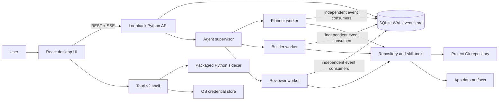

# Tribe runtime and application architecture

Tribe is a local-first desktop harness. The React UI is a projection of a durable SQLite event log; agents independently consume the same mission stream and use atomic work claims when parallel work is useful.

## Components and boundaries

- `src/`: React workspace, mission channel with task-linked activity and task filters, agent lanes, read-only plan, user request queue, artifact preview and review threads, collaborative Canvas editor, skills and project knowledge. Canvas supports Markdown, text, code and Mermaid diagram source; human edits create immutable revisions, agent changes are proposals based on an explicit revision, and anchored comments can be assigned to an agent. File and command tool start/finish events share one timeline row, including when history is loaded across pages.
- Background command runs are part of mission bootstrap and refresh from start/finish events, so status and bounded output remain visible after navigation or reload.
- `src/api/runtime.js`: transport boundary. Browser preview uses the Vite `/api` proxy; the packaged Tauri app uses the loopback service directly and subscribes through Server-Sent Events. While SSE reconnects, the client pages through the durable event log in batches of 200 and reconciles buffered events in sequence order.
- `recipes/*.md` and `runtime/tribe_runtime/recipes.py`: validated Markdown workflow definitions with built-in defaults, user overrides and atomic version updates. Selecting a recipe stores its complete versioned snapshot on a mission; every agent receives it as advisory context, while the mission channel and shared task board remain authoritative.
- Project web access is opt-in and stored in SQLite. Pydantic AI's local `WebSearch` and `WebFetch` tools are composed only when enabled; Tribe's deferred approval hook gates each exact query and URL. Fetches require exact hostname allowlisting and use Pydantic AI's SSRF-protected downloader. Provider-native web tools are deliberately disabled so requests remain visible to Tribe's approval UI.
- Project memories retain their source mission and author. User-authored entries are active immediately; agent proposals live in a separate pending queue and enter agent context only after user acceptance. Accepted memories can be archived or restored, with each transition recorded in the source mission event log.
- `src-tauri/`: Tauri v2 window, native repository picker, Python sidecar lifecycle, restricted plugin capabilities, and per-user app data location. On desktop exit, Tauri asks the loopback runtime to shut down and waits for command process trees to stop before forcing sidecar termination.
- `runtime/tribe_runtime/server.py`: loopback HTTP API. Cross-origin access is limited to local preview origins and Tauri origins.
- `store.py`: one SQLite database in the user data directory; ordered append-only events are the communication source of truth. Work, prerequisite edges, interaction, consumer offset, per-agent event-run, command-run, Canvas document/version/proposal/comment tables are durable projections. Canvas publications and their source channel post commit in one transaction; revisions use optimistic concurrency, and proposal acceptance checks the exact base revision. Task claims are atomic and exclude work whose prerequisite items are not complete. Agent result publication/failure and offset advancement commit in one transaction.
- `agent_runtime.py`: Pydantic AI 2 adapter and independent event workers. Agent runs compose the Harness filesystem, shell, and Agent Skills capabilities with Tribe-specific mission tools. Agents can list/read mission artifacts and read, start or reply to review threads; a user comment wakes only the independent reviewer. Project MCP toolsets are loaded through Pydantic AI's standard `mcpServers` loader for each run. Typed Harness events feed the durable mission log; filesystem writes reuse Tribe's cross-process path locks and produce diff artifacts. Tool-call events expose concise activity without model reasoning or raw tool output.
- Model credentials are resolved per provider and passed directly to each Pydantic AI provider instance. Agent workers do not swap API keys through process-wide environment variables, so concurrent roles can use different providers safely. The Settings form accepts Pydantic AI provider IDs beyond its suggested common providers; optional provider SDKs remain build dependencies. Pydantic AI's `litellm:` provider connects to a LiteLLM proxy over HTTP without embedding the LiteLLM SDK.
- Settings can run an explicit provider capability check against the configured model. It offers one harmless in-memory tool, caps output and total tokens, times out after 20 seconds, and reports connectivity separately from tool calling. It runs only when the user selects **Test connection**; it does not poll in the background. A live check of `ollama:qwen2.5-coder:7b` confirmed connectivity but did not observe a tool call.
- Settings can export either a transaction-consistent SQLite backup or a versioned project audit JSON. The audit streams missions, ordered event payloads and artifact metadata without loading the full history into memory; it omits the project root, artifact file paths and artifact contents. Event payloads may still include repository paths, user messages, agent messages and tool activity, so the UI labels that export as potentially sensitive.
- Pydantic AI providers that accept a custom service URL can be configured with one endpoint. The URL is persisted in the local settings store; HTTPS is required for remote hosts, HTTP is accepted only for loopback hosts, and URL credentials/query strings are rejected. OpenAI-compatible local services, LiteLLM proxies and vLLM can be configured without a provider key when appropriate; the standard provider endpoint is used when the URL is blank.
- `harness_capabilities.py`: an explicit capability composition boundary. Tribe does not use the `Coder` composite because its built-in shell is unrestricted and it includes self-delegation; independent Tribe consumers remain the only agent topology. Harness shell commands are allowlisted as an accident guardrail. Pydantic AI Harness `StepPersistence` records run snapshots and tool-effect state in a separate `agent_steps.sqlite3` database. Completed snapshots restore each agent's own prior conversation for its next mission event, while interrupted snapshots are excluded; the recovery message and durable interruption activity provide context without replaying the uncertain checkpoint. Harness sliding-window compaction bounds retained messages. Shell and non-read-only MCP actions persist the exact tool-call arguments and Pydantic message frontier with the mission interaction. An approved call resumes once through Pydantic AI's deferred-tool mechanism. MCP tool activity is recorded with concise arguments; sensitive fields are redacted in approval cards. If approval was consumed but the side effect's outcome is unknown after a crash, Tribe stops replay and records the run as needing attention.
- `mcp_registry.py`: project-scoped standard MCP configuration, validated and atomically stored under the user data directory. Stdio working directories must remain inside the project's repository; HTTP endpoints require HTTPS or loopback HTTP. Credentials use environment references in JSON and values are stored separately in the OS credential store, scoped to project and variable name; process environment values take precedence. Resolved runtime configuration exists only in permission-restricted temporary files while Pydantic AI constructs toolsets or performs a user-triggered server check, then is removed. Settings can check connectivity, inspect advertised tools, and disable a server or individual tools; those controls are applied before each agent receives its toolset. Read-only tool names are an explicit per-server user allowlist; all other calls require individual approval. The runtime delegates protocol transport and tool discovery to Pydantic AI. `oauth_store.py` now provides a keychain-backed FastMCP `AsyncKeyValue` implementation, but the OAuth connection flow is not wired into the registry yet.
- MCP is Tribe's first connector protocol, not a model-provider or agent-runtime abstraction. Keep future native service integrations behind connector adapters; neither should leak host-specific APIs into mission, approval or artifact domain code. Connection credentials, scopes, advertised capabilities, health and exact-call approvals belong to the connector boundary.
- The MCP Settings preset adds Microsoft's pinned Playwright MCP server for browser-based verification. The connection check verifies Node.js 18+ and `npx`, then calls only the read-only `browser_snapshot` tool in the isolated headless session to verify that the browser launches; the result is discarded, and the check never navigates or interacts with a page. Page snapshots, screenshots, search and console inspection are read-only; navigation, interaction and network inspection use the durable exact-call approval path. Tribe removes Playwright's arbitrary-code execution tool from the exposed toolset. A project website list configures Playwright's origin guardrail, but does not enforce network egress and can be bypassed by redirects. Browser pages remain untrusted external content.
- `workspace.py`: repository boundary, traversal checks, bounded read-only file browsing, per-path locks, atomic legacy writes, change artifacts, one-use deletion approval, isolated Git worktree review/integration, and test subprocesses that do not inherit API keys or other credential-bearing environment variables. Goal-driven SDLC repository actions through these tools require a live self-claimed plan item; the Harness file-write event and shell hooks enforce the same claim gate, keeping repository work tied to the read-only plan projection.
- `agents/*.md`: built-in role/persona definitions. The Agents workspace writes user roles as Markdown into the user data directory and registers them with active missions. These are data, not executable plugins. Startup rejects malformed front matter, missing required fields, unsafe IDs, and duplicate IDs with the offending file path.
- `skills.py`: read-only discovery of portable `SKILL.md` packages across Agent Skills, Claude, Codex, GitHub Copilot, Cursor, Gemini CLI and OpenCode locations, plus OpenCode flat Markdown skills, Claude/Codex plugin caches, and configured roots. Project scanning skips dependency/build trees and is capped at 20,000 directories. Pydantic AI Harness loads valid directory skills on demand; Tribe's compatibility catalog also exposes bounded text references. Nested-root scope is shown to agents but not enforced against task paths. Skill text is task guidance, never permission policy.
- `credentials.py`: OS keychain storage with provider-specific environment-variable fallbacks. PydanticAI resolves native `provider:model` identifiers for OpenAI, Anthropic, Google, Groq, Mistral, DeepSeek, OpenRouter, xAI, Cerebras, Cohere, Fireworks, Together AI and Ollama. Custom OpenAI-compatible endpoints can route through LiteLLM or another compatible gateway. Coding-agent harness subscriptions are not model-provider backends; Codex and Claude are usability and feature benchmarks. Ollama uses a local OpenAI-compatible endpoint by default and does not require a key for local inference.
- Agent Markdown may set an optional `model: provider:model-name` override and `repository_access: read_only|workspace_write`; model overrides inherit the workspace default when omitted. Planner and reviewer default to `read_only`. Read-only roles keep channel, plan, repository inspection and bounded test tools, while write-capable Tribe tools, Harness FileSystem/Shell capabilities, and MCP tools not explicitly declared read-only are removed. A write event is also cancelled at the Harness file-change hook. Each role resolves its provider credential from the OS keychain or that provider's environment variable, and credential values never enter agent files. A role with an unavailable provider is marked as needing configuration while other roles continue to consume the mission channel.

## Data model

`Project` identifies one local Git repository, has a user-owned goal and owns reusable knowledge. `Mission` is a durable session with its own goal and one shared channel. Agents maintain mission `WorkItem` rows with durable prerequisite edges; atomic self-claim excludes work until all prerequisites complete. Only the independent reviewer can complete a mission, and completion requires all work done, a completed reviewer-owned item, no pending user requests, a summary and one or more evidence IDs that resolve to a successful test/command event or an artifact in that mission. After completion, the user can append an outcome review (`accepted`, `follow_up`, or `rejected`) with notes; reviews remain in event history rather than mutating the original completion. A pending user request automatically blocks a mission when no work is ready or claimed; an agent may also persist a specific blocked reason. The reason clears automatically when the final pending request is resolved. Kanban is a read-only projection and agents cannot update the project goal. Each mission has ordered `Event` records, pending `Interaction` rows, file-output `Artifact` metadata and available Canvas documents. File-output bytes live under the app data directory, outside the repository. File review threads are anchored to a SHA-256 content hash. Canvas documents have one owning mission and an immutable project-wide revision history; a user may link a document into another mission within the same project. Linked agents can read and propose against the canonical document, while proposals, comments and review decisions remain mission-scoped. Unlinking revokes that mission's access without deleting the document or its owner-mission history. Proposal acceptance checks the exact base revision; users can apply selected diff hunks and the accepted body becomes a new user-authored revision. Canvas publication is stored atomically with the source agent channel event. User messages, project-goal changes and decisions are events; agent and tool activity is recorded before the UI projects it.

SQLite uses `PRAGMA user_version` for schema compatibility. Existing unversioned stores are upgraded idempotently without deleting rows; schema version 1 stores gain a project goal backfilled from each project's first mission. Schema version 5 adds a per-agent event-run ledger, version 6 adds persisted command runs, version 7 adds task prerequisite edges, version 8 adds background missions plus durable schedules and run history, version 9 adds provider-reported usage per agent run, version 10 adds project monthly token budgets and atomic per-run reservations, version 11 adds each mission's recipe identity, version and immutable workflow snapshot, version 12 adds opt-in project web access policy, version 13 adds project memory provenance and the agent proposal/review lifecycle, version 14 adds durable mission blocked reasons, version 17 adds artifact review threads and comments, version 18 adds Canvas documents, immutable revisions, agent proposals and anchored comment threads, and version 19 adds same-project mission links for shared Canvas documents. Unknown usage after an interrupted or failed provider call conservatively keeps its reservation until the UTC month changes. Pydantic AI applies per-run usage limits; provider-side charges can still vary when usage is missing or a request is already in flight. A due schedule waits until agents are configured; overdue intervals coalesce into one run after the local runtime is available. Opening a store from a newer runtime version fails clearly before database settings or rows are changed.

A one-time schedule remains active while its mission runs, pauses, or waits for the user. Reconciliation marks it complete only after the mission completes, in the same transaction that closes its scheduled-run record; this also prevents a due one-time schedule from being dispatched again after a restart.

The mission channel loads the latest 200 events at startup and fetches earlier pages on demand. Live stream delivery and reconnect recovery also page forward from the last sequence, so long-running missions retain their full append-only history without materialising the full backlog at once. Users can pause or resume the active mission from its header; a pause stops workers after their current provider or tool action, and the control reports agents still finishing that action.

Pending approvals and clarification requests are indexed across all projects by the local runtime. The top-bar `Needs you` queue refreshes independently of the selected mission and shows the exact approval target plus originating project/mission. Selecting a request navigates to its mission without resuming it, so a paused mission stays paused. Decisions happen in that mission's approval card above the composer and are persisted to its event log. If an approval is granted while its mission is paused, the deferred tool call waits until the mission resumes before it can run.

Work claims use a SQLite immediate transaction and expiring lease so two agents cannot claim the same ready item. The store also limits each agent to one unexpired claim at a time, and workers renew their claims during long model/tool runs; a stopped process leaves the lease to expire for recovery. Workers consume the durable event log in bounded 200-event pages, including after a long offline period. Every runtime start wakes each worker to resume or claim available work. Workers check the durable mission state before consuming events, so pausing prevents new runs even if an in-memory stop signal is missed. Explicitly paused workers finish any in-flight provider or tool action, then stop; they restart only after the mission is resumed. Switching missions pauses the previous mission using the same state transition. Changing the model or key also restarts active workers after their current calls finish; unsupported providers are rejected before credentials or settings are changed. File-change and test-result events wake the reviewer role; plan changes can wake all roles. Agents receive a bounded current-board snapshot and can list or revise unfinished tasks; a claimed task can only be revised by its current owner. Each model run is capped at eight requests, 24 tool calls, 8,000 output tokens and 128,000 total tokens by default; project-specific run limits can override the total. Each triggered event has a durable per-agent run state. On restart, an unfinished row is replayed; completion or terminal failure is recorded with its result/activity event and consumer offset in one transaction, so the final publication cannot be duplicated or skipped by a crash between those writes. Provider retries remain capped at three, but a failed attempt is retried only if it emitted no agent-authored mission event. This avoids repeating observable channel and tool activity; operation-level idempotency is still needed for side effects that occur without a durable event. User messages reach the whole team by default; selecting an agent in the composer records the recipient and wakes only that agent. Agent broadcasts are logged for the team but do not wake every worker; a message wakes another worker only when addressed to its agent id or role. Direct agent messages carry a reply-chain id, allow one addressed message per run and stop after three hops. Repository writes share a checkout by default and are serialised per path with an in-memory thread lock plus an OS file lock. Separate runtime processes coordinate only when they use the same data directory, because the lock files are stored there. Deletions require a one-use approval for the exact resolved path; approval consumption happens while holding that path lock. No bulk approval exists.

For risky work, an agent can create a detached worktree outside the project repository. The current repository must be clean before isolation starts. The agent's repository tools then target that worktree. To integrate, the agent stages its own worktree changes, publishes a patch artifact, and requests one-time approval for applying that specific patch to the project checkout. The runtime checks the reviewed patch against the current checkout while holding the same cross-process path locks used by ordinary writes. Conflicts leave the worktree available for revision. Users can discard an isolated worktree from the mission view; the exact path is shown in the confirmation, and any pending integration request is cancelled.

## Run locally

Install frontend dependencies, then run `npm run dev`. This starts the loopback runtime and Vite preview. Add an existing Git repository and define the first mission. Configure an `openai:` or `anthropic:` model identifier and corresponding key in Settings to enable hosted model-driven workers. For local inference, run an Ollama server and configure a model such as `ollama:qwen3`; it defaults to `http://127.0.0.1:11434/v1`, does not require a key for local use, and accepts `TRIBE_OLLAMA_BASE_URL` to select another endpoint. Create additional Markdown roles from the Agents workspace; they are saved under `<user data directory>/agents` and join active missions. The browser preview stores data under `~/.tribe/` by default; the desktop app uses its OS-managed application data directory. Set `TRIBE_DATA_DIR` to relocate either runtime's data.

Run the runtime invariant suite with `uv run --project runtime --extra ai python -m unittest discover -s runtime/tests`.

For a desktop package, sync Python extras with `uv sync --project runtime --extra ai --extra desktop`, then run `npm run desktop:dev` or `npm run desktop:build`. The runtime packaging command builds a target-specific PyInstaller binary. The checked-in GitHub workflow runs the runtime invariant and Sites packaging checks, builds the macOS arm64 app bundle or Windows x64 installers, constructs every configured Pydantic AI provider inside the frozen sidecar without network calls or credential-store writes, then launches the sidecar, configures Ollama, verifies project creation and the versioned project-audit export, and checks runtime health before uploading the bundle. Its optional live-inference mode also verifies that an agent self-claims work and posts to the mission channel.

## Current limits

- Tribe resolves `provider:model` identifiers through Pydantic AI 2.61.0 and provides API-key setup for OpenAI, Anthropic, Google, Groq, Mistral, DeepSeek, OpenRouter, xAI, Cerebras, Cohere, Fireworks, Together AI and Ollama; Pydantic AI Harness 0.61.0 is pinned because its 0.x API may change between minor releases. OpenAI-compatible gateways, including a LiteLLM proxy, can be configured through the custom endpoint; Tribe does not currently embed the LiteLLM SDK. Coding-agent harness subscriptions are not supported as model providers; Codex and Claude are usability and feature benchmarks. Agent tools require native tool-calling support from the selected model. If a model returns a tool call as ordinary text, Tribe reports the run as failed and never executes that text. Settings can discover Ollama models at `127.0.0.1:11434`; local inference still requires a separately installed and running Ollama server, and selecting a model does not configure it until the user saves the provider settings.
- Harness shell execution is constrained by built-in and project-scoped executable allowlists, but those allowlists are guardrails, not operating-system sandboxes. Deferred shell and MCP approvals and their resume frontier are durable. At startup, command runs still marked `running` are changed to `interrupted` with one durable event; Tribe preserves captured output and does not relaunch the process or guess its exit status. Agent runs also have interrupted-state recovery and release their claims, but operation-level idempotency for side effects with unknown outcomes remains incomplete. Browser navigation and state-changing actions use the durable exact-call approval path; network egress still needs enforcement. Current one-time approvals also cover file deletion and isolated patch integration. MCP configuration changes take effect on the next agent turn. OAuth setup, secret rotation and finer credential scope remain future work; server health checks and per-tool enable/read-only controls are available in Settings.
- Per-run request, tool-call and token limits bound runaway work. Ollama does not support Pydantic AI's optional pre-request token-counting pass, so Tribe disables that pass for Ollama while retaining provider-reported per-run limits after each response; an oversized request may still be sent once. Completed runs store Pydantic AI's best-effort USD estimate when its installed model-price data can price the provider response; unknown prices remain null. Estimates are not a monetary spend ceiling. The local runtime refreshes model-price data in the background at startup and hourly.
- User roles can be created and edited in the Agents workspace. Editing is saved atomically and active mission workers reload after current calls finish. Archiving a role removes it from active missions after in-flight calls finish and moves its Markdown definition under `agents/archive/` for recovery.
- Isolation uses explicit detached worktrees for risky work and requires a clean project checkout before creation.
- Agent skill scripts are not executed. Skills that depend on scripts need their steps performed with the runtime's approved repository tools or remain unsupported.
- Pydantic AI's available provider IDs are accepted directly, but credential setup currently supports single-key providers. Cloud providers that need multiple credentials, account discovery or interactive OAuth still need provider-specific setup in Tribe. The service uses one fixed loopback port and does not yet support multiple simultaneous Tribe instances.
- On 25 October 2026, an app-only macOS arm64 rebuild with explicit CI target produced a 93.40 MiB `.app` containing the current frontend, native shell and Python sidecar. The repository bundle verifier passed against that target-specific artifact. The exact packaged sidecar smoke check constructed all 14 configured Pydantic AI provider classes, verified health and local-model discovery, created a project and mission, exported its audit, and shut down cleanly. Earlier packaged checks also verified an Ollama agent self-claiming work and posting to the mission channel, and launched the app with clean sidecar shutdown. The macOS native ScreenCaptureKit picker still needs interaction acceptance in the packaged app; visual review remains unavailable in this environment. On this macOS 27 host, the Rust test binary aborts without an environment override because `/usr/lib/swift/libswift_Concurrency.dylib` is absent. Pointing `DYLD_LIBRARY_PATH` at Xcode's Swift 5.5 runtime lets all four tests execute, but produces a duplicate `SwiftNativeNSObject` warning; this is a local host/runtime limitation, not a validated release setup. The optional DMG layout step stalled in its AppleScript/Finder stage, so no completed DMG is verified. The Windows Rust shell and test code now pass `cargo check --tests --target x86_64-pc-windows-msvc` on this host using rustup's Windows standard library, Homebrew LLVM's `llvm-rc`, and a temporary placeholder for Tauri's target-specific sidecar path. This type-check does not link, run, package, or verify WebView2 on Windows. The Windows x64 CI installer and app-lifecycle checks still need a successful Windows runner. Signing, notarisation and update delivery need release credentials and release configuration.
- The browser UI could not be screenshot-reviewed in this environment because local browser navigation was declined by the environment approval gate.
